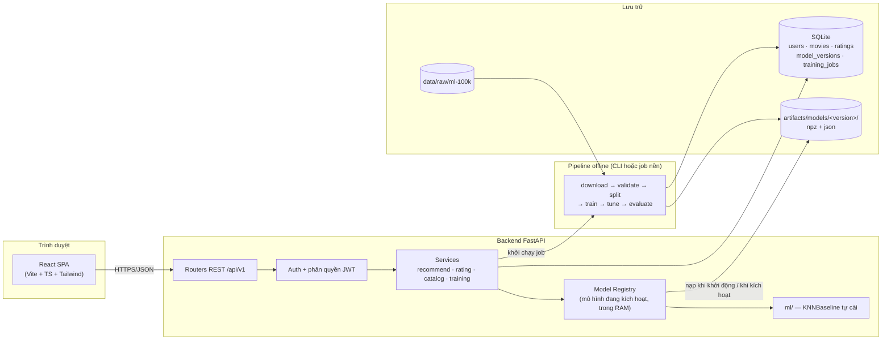
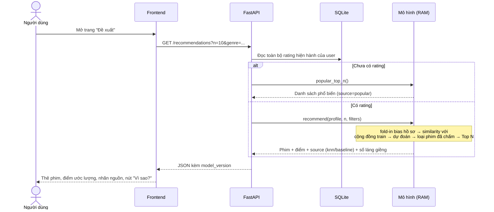
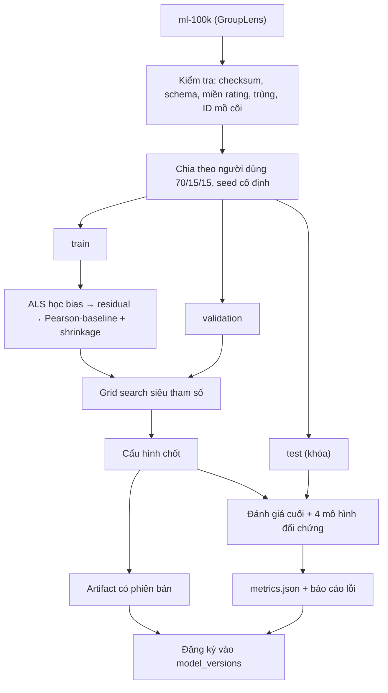
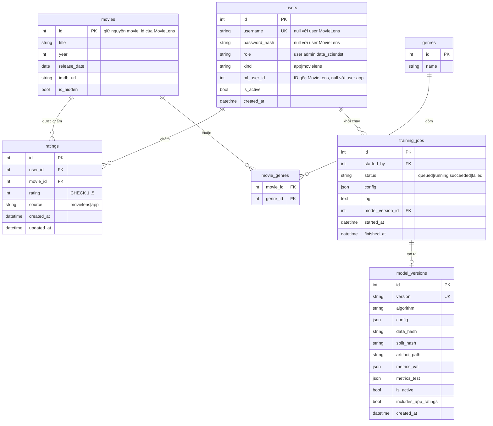

# PLAN TRIỂN KHAI — Hệ thống đề xuất phim cá nhân hóa bằng KNNBaseline (Website full-stack)

**Môn học:** Hệ thống thông minh (Intelligent Systems) — HK261
**Repo:** <https://github.com/Kryslogem/knn-recommend>
**Thuật toán chính:** User-based KNNBaseline (ALS học bias + Pearson-baseline + shrinkage)
**Dataset:** MovieLens 100K (dữ liệu thật, GroupLens)
**Sản phẩm:** Website gồm backend API + frontend SPA + pipeline ML offline
**Ngày lập:** 10/11/2026

> Tài liệu này là bản kế hoạch triển khai, kế thừa đặc tả trong `README.md` và `desc.md` của repo.
> Thay đổi lớn nhất so với đặc tả: **bỏ Streamlit, chuyển sang kiến trúc website backend + frontend tách rời**.
> Mọi con số metrics trong tài liệu đều **chưa đo**; không điền số giả vào báo cáo.

---

## Mục lục

1. [Quyết định thiết kế chính](#1-quyết-định-thiết-kế-chính)
2. [Đối chiếu rubric → việc phải làm](#2-đối-chiếu-rubric--việc-phải-làm)
3. [Kiến trúc tổng thể](#3-kiến-trúc-tổng-thể)
4. [Cấu trúc thư mục](#4-cấu-trúc-thư-mục)
5. [Danh sách tính năng đầy đủ](#5-danh-sách-tính-năng-đầy-đủ)
6. [Cơ sở dữ liệu](#6-cơ-sở-dữ-liệu)
7. [Pipeline ML offline](#7-pipeline-ml-offline)
8. [Thuật toán — đặc tả để cài đặt](#8-thuật-toán--đặc-tả-để-cài-đặt)
9. [Đánh giá](#9-đánh-giá)
10. [Backend API](#10-backend-api)
11. [Frontend](#11-frontend)
12. [Kiểm thử và xử lý đầu vào](#12-kiểm-thử-và-xử-lý-đầu-vào)
13. [Lộ trình triển khai theo giai đoạn](#13-lộ-trình-triển-khai-theo-giai-đoạn)
14. [Lệnh chạy dự kiến](#14-lệnh-chạy-dự-kiến)
15. [Bộ nộp và báo cáo](#15-bộ-nộp-và-báo-cáo)
16. [Rủi ro](#16-rủi-ro)
17. [Kịch bản demo](#17-kịch-bản-demo)

---

## 1. Quyết định thiết kế chính

| Hạng mục | Lựa chọn | Lý do |
|---|---|---|
| Backend | **Python + FastAPI** | Cùng ngôn ngữ với phần ML nên mô hình chạy **trong tiến trình API** (tích hợp thật, không gọi notebook); tự sinh Swagger để demo API |
| ORM / DB | **SQLAlchemy + SQLite** | Đủ cho MVP, không cần cài server DB; đổi sang PostgreSQL sau chỉ cần đổi connection string |
| Frontend | **React + Vite + TypeScript + Tailwind CSS** | SPA nhẹ, dễ dựng nhanh; Recharts cho biểu đồ metrics |
| Gọi API phía client | TanStack Query + fetch/axios | Tự cache và làm mới danh sách đề xuất sau khi chấm điểm |
| Xác thực | **JWT + mật khẩu băm (bcrypt/argon2)**, 3 vai trò | Website nhiều người dùng cần phân quyền thật ở phía server (thay cho "bộ chọn hồ sơ" của bản Streamlit) |
| Thuật toán | **Tự cài bằng NumPy/SciPy** | Rubric chấm "correct implementation" 10đ và Q&A; nhóm phải giải thích được từng bước |
| Thư viện đối chiếu | `scikit-surprise` (chỉ dùng trong test, tùy chọn) | So kết quả tự cài với bản tham chiếu; không phụ thuộc lúc chạy web |
| Huấn luyện | CLI script **và** nút trên trang Data Scientist (chạy nền) | Thể hiện rõ vai trò Data Scientist trong hệ thống |
| Artifact mô hình | `.npz` + `.json` theo thư mục phiên bản | Nạp nhanh, tái lập, hoán đổi phiên bản không cần khởi động lại |
| Đóng gói | Chạy local bằng 2 lệnh; Docker Compose là tùy chọn | Ưu tiên demo chắc chắn chạy trên máy nhóm |

**Ba vai trò trong hệ thống**

| Vai trò | `role` | Quyền |
|---|---|---|
| Người dùng | `user` | Tìm phim, chấm điểm, xem lịch sử, nhận đề xuất + giải thích |
| Quản trị viên | `admin` | Mọi quyền của user + quản lý tài khoản, danh mục phim, xem trạng thái hệ thống |
| Data Scientist | `data_scientist` | Kiểm tra dữ liệu, cấu hình & chạy huấn luyện, xem metrics, kích hoạt phiên bản mô hình |

---

## 2. Đối chiếu rubric → việc phải làm

| Tiêu chí (điểm) | Rubric yêu cầu | Bằng chứng cần tạo ra | Nằm ở đâu |
|---|---|---|---|
| Problem & requirements (10) | Mục tiêu, phạm vi, stakeholder (có Data Scientist), FR/NFR | Bảng FR/NFR, stakeholder | Báo cáo §1–3; mục 5 tài liệu này |
| Analysis & design (15) | Use-case diagram + mô tả (8); kiến trúc, data flow/UI (7) | Sơ đồ UML use case chuẩn (ellipse), 2 mô tả UC, sơ đồ kiến trúc, data flow, ảnh chụp UI | `docs/diagrams/`, mục 3 |
| Data & ML workflow (15) | Nguồn + preprocessing (7); split, chống leakage, training workflow (8) | Script tải + checksum, báo cáo kiểm tra dữ liệu, split cố định seed, test chống leakage | `ml/data/`, mục 7 |
| Algorithm & evaluation (25) | Chọn & giải thích (7); cài đặt đúng (10); metrics, baseline, phân tích lỗi (8) | Code tự cài + unit test tính tay + đối chiếu Surprise; bảng 5 mô hình; phân tích lỗi | `ml/models/`, `ml/eval/`, mục 8–9 |
| System & integration (25) | MVP + user workflow (10); tích hợp thuật toán thật (10); test/input handling (5) | Website chạy end-to-end; `/recommendations` gọi mô hình thật; validation + test suite | `backend/`, `frontend/`, mục 10–12 |
| Demo & report (10) | Demo + Q&A (6); báo cáo, đóng góp | PDF, slide, kịch bản demo, bảng đóng góp, khai báo AI | `docs/`, mục 15, 17 |

**Ràng buộc cứng của rubric**

- Thuật toán phải xử lý dữ liệu và trả kết quả **bên trong hệ thống** → đề xuất được tính trực tiếp khi gọi API, không đọc file kết quả tính sẵn.
- **Không dùng dữ liệu mô phỏng** → chỉ MovieLens 100K thật; dữ liệu tự tạo chỉ dùng trong unit test tính tay và phải ghi rõ.
- Hệ thống không chạy hoặc không tích hợp thuật toán thì mất điểm phần 25đ → ưu tiên luồng chính chạy được trước khi làm đẹp.

---

## 3. Kiến trúc tổng thể



**Nguyên tắc phân lớp**

- `ml/` là package Python thuần, **không phụ thuộc FastAPI hay DB** → dùng chung cho CLI, test và backend.
- `backend/` chỉ điều phối: xác thực → đọc lịch sử từ DB → gọi `ml` → trả JSON.
- Frontend không chứa logic đề xuất nào; mọi điểm dự đoán đến từ API.

### 3.1. Luồng online — nhận đề xuất



### 3.2. Luồng offline — huấn luyện



---

## 4. Cấu trúc thư mục

```text
knn-recommend/
├── README.md                  # Hướng dẫn chạy đã kiểm chứng
├── PLAN.md                    # Tài liệu này
├── desc.md                    # Đặc tả gốc
├── .gitignore                 # data/raw, artifacts, *.db, node_modules, .venv
├── configs/
│   ├── data.yaml              # URL, checksum, tỉ lệ split, seed
│   ├── model.yaml             # Siêu tham số mặc định
│   └── grid.yaml              # Lưới tuning
├── data/                      # KHÔNG commit dữ liệu gốc
│   ├── raw/ml-100k/
│   └── processed/             # train/val/test .parquet|.csv + split_manifest.json
├── artifacts/
│   ├── models/<version>/      # model.npz, meta.json, metrics.json
│   └── reports/               # data_report.json, tuning.csv, comparison.csv, hình
├── ml/                        # Package thuật toán (thuần Python)
│   ├── data/
│   │   ├── download.py        # Tải + kiểm tra checksum
│   │   ├── load.py            # Đọc u.data, u.item, u.genre
│   │   ├── validate.py        # Kiểm tra chất lượng → data_report.json
│   │   └── split.py           # Chia per-user, ghi manifest
│   ├── models/
│   │   ├── baseline.py        # ALS học bias (+ SGD tùy chọn)
│   │   ├── similarity.py      # Pearson, Pearson-baseline, shrinkage
│   │   ├── knn.py             # KNNBasic, KNNBaseline: fit/predict
│   │   ├── popular.py         # Đối chứng phim phổ biến
│   │   ├── foldin.py          # Suy luận cho hồ sơ ngoài train
│   │   └── artifact.py        # save/load + phiên bản
│   ├── eval/
│   │   ├── metrics.py         # MAE, RMSE, P@K, R@K, NDCG@K, coverage
│   │   ├── evaluate.py        # Chạy đánh giá 1 mô hình trên 1 tập
│   │   ├── tune.py            # Grid search trên validation
│   │   └── error_analysis.py  # Phân nhóm lỗi
│   └── pipeline.py            # Hàm run_training(config) dùng chung CLI + API
├── scripts/                   # CLI mỏng gọi vào ml/
│   ├── prepare_data.py
│   ├── train.py
│   ├── tune.py
│   ├── evaluate.py
│   └── seed_db.py             # Nạp phim, user MovieLens, tài khoản mẫu
├── backend/
│   ├── requirements.txt
│   ├── app/
│   │   ├── main.py            # Tạo app, CORS, lifespan nạp mô hình
│   │   ├── config.py          # Đọc .env
│   │   ├── db.py              # Engine, session
│   │   ├── models.py          # Bảng SQLAlchemy
│   │   ├── schemas.py         # Pydantic request/response
│   │   ├── security.py        # Băm mật khẩu, JWT, require_role()
│   │   ├── registry.py        # ModelRegistry: load/activate/hot-swap
│   │   ├── routers/
│   │   │   ├── auth.py
│   │   │   ├── movies.py
│   │   │   ├── ratings.py
│   │   │   ├── recommendations.py
│   │   │   ├── admin.py
│   │   │   └── ds.py          # Data Scientist
│   │   └── services/
│   │       ├── recommend_service.py
│   │       ├── rating_service.py
│   │       ├── catalog_service.py
│   │       └── training_service.py
│   └── tests/
├── frontend/
│   ├── package.json
│   ├── vite.config.ts         # proxy /api → :8000
│   └── src/
│       ├── api/               # client + kiểu dữ liệu
│       ├── auth/              # AuthContext, ProtectedRoute, RoleRoute
│       ├── components/        # MovieCard, StarRating, ExplainDrawer, MetricTable...
│       ├── pages/             # xem mục 11
│       └── App.tsx
├── tests/                     # Test cho package ml/
│   ├── test_baseline.py
│   ├── test_similarity.py
│   ├── test_knn_handcalc.py
│   ├── test_foldin.py
│   ├── test_split_leakage.py
│   ├── test_metrics.py
│   └── test_vs_surprise.py    # skip nếu chưa cài surprise
└── docs/
    ├── report/                # Nguồn báo cáo + PDF
    ├── diagrams/              # Use case, kiến trúc, data flow
    ├── slides/
    ├── contributions.md
    └── ai_disclosure.md
```

---

## 5. Danh sách tính năng đầy đủ

Mức ưu tiên: **P0** = bắt buộc cho MVP · **P1** = nên có · **P2** = mở rộng nếu còn thời gian.

### 5.1. Người dùng

| Mã | Tính năng | Chi tiết / điều kiện nghiệm thu | Ưu tiên |
|---|---|---|---|
| U01 | Đăng ký, đăng nhập, đăng xuất | Chỉ cần username + mật khẩu (không thu email/tên thật — NFR07); JWT | P0 |
| U02 | Duyệt và tìm phim | Tìm theo tên (không phân biệt hoa thường), lọc thể loại, năm; phân trang | P0 |
| U03 | Xem chi tiết phim | Tên, năm, thể loại, điểm TB và số lượt chấm (tính từ train), điểm của tôi | P0 |
| U04 | Chấm / sửa / xóa điểm | 1–5 sao nguyên; mỗi cặp user–phim một điểm hiện hành | P0 |
| U05 | Lịch sử đánh giá | Danh sách phim đã chấm, sắp xếp, sửa tại chỗ | P0 |
| U06 | Nhận Top-N đề xuất | Tính bằng mô hình thật, loại phim đã chấm, lọc thể loại, N ≤ 50 (mặc định 10) | P0 |
| U07 | Giải thích đề xuất | Nguồn `knn` / `baseline` / `popular`; phân rã `μ + b_u + b_i + phần láng giềng`; số láng giềng thực dùng; các phim chung nổi bật với láng giềng | P0 |
| U08 | Onboarding cold-start | User mới thấy phim phổ biến + lời mời chấm ≥ 5 phim; thanh tiến độ | P0 |
| U09 | Dự đoán điểm cho 1 phim | Trang chi tiết hiện "Điểm dự đoán cho bạn" | P1 |
| U10 | Tự làm mới đề xuất | Sau khi chấm điểm, danh sách đề xuất được tính lại (invalidate cache) | P0 |
| U11 | Poster phim | Lấy từ nguồn ngoài (vd. TMDB) theo tên + năm; mặc định dùng thẻ màu theo thể loại | P2 |

### 5.2. Quản trị viên

| Mã | Tính năng | Chi tiết | Ưu tiên |
|---|---|---|---|
| A01 | Bảng trạng thái hệ thống | Số user, phim, rating; phiên bản mô hình đang chạy; thời điểm nạp; độ trễ đề xuất gần đây; tỉ lệ fallback | P0 |
| A02 | Quản lý tài khoản | Liệt kê, đổi vai trò, khóa/mở | P1 |
| A03 | Quản lý danh mục phim | Xem, sửa tên/thể loại, ẩn phim khỏi đề xuất | P1 |
| A04 | Xem đề xuất của một hồ sơ MovieLens | Chọn user ID 1–943 để minh họa mô hình với lịch sử thật | P1 |

### 5.3. Data Scientist

| Mã | Tính năng | Chi tiết | Ưu tiên |
|---|---|---|---|
| D01 | Báo cáo dữ liệu | Số dòng, độ thưa, phân bố rating, số rating/user và /phim, kết quả kiểm tra (trùng, ngoài miền, ID mồ côi), checksum | P0 |
| D02 | Thông tin split | Kích thước train/val/test, seed, hash manifest | P0 |
| D03 | Chạy huấn luyện | Form siêu tham số (K, min_k, reg_u, reg_i, n_epochs, shrinkage, min_support) → job nền → theo dõi trạng thái + log | P0 |
| D04 | Danh sách phiên bản mô hình | Cấu hình, hash dữ liệu, thời điểm, metrics validation/test | P0 |
| D05 | Kích hoạt phiên bản | Hot-swap mô hình đang phục vụ, không cần khởi động lại | P0 |
| D06 | Bảng so sánh mô hình | 5 mô hình × các metrics, kèm biểu đồ | P0 |
| D07 | Kết quả tuning | Biểu đồ RMSE/NDCG theo K và shrinkage trên validation | P1 |
| D08 | Phân tích lỗi | Lỗi theo nhóm (số rating của user, độ phổ biến phim, số láng giềng, giá trị rating thật) | P1 |
| D09 | Cập nhật mô hình với rating từ app | Huấn luyện phiên bản mới có gộp rating người dùng web; phiên bản này **không** kế thừa metrics test cũ | P2 |

### 5.4. Yêu cầu phi chức năng

| Mã | Yêu cầu | Cách kiểm chứng |
|---|---|---|
| NFR01 | Hiệu năng: Top-10 trong ≤ 2 giây sau khi mô hình đã nạp (mục tiêu) | Đo p50/p95 qua middleware, ghi cấu hình máy vào báo cáo |
| NFR02 | Tái lập: cùng dữ liệu + seed + config → cùng split và cùng metrics | Test chạy pipeline 2 lần, so hash |
| NFR03 | Nhất quán: rating còn sau khi khởi động lại; sửa điểm → đề xuất thay đổi | Test tích hợp |
| NFR04 | Dễ dùng: từ đăng ký đến nhận đề xuất ≤ 3 bước rõ ràng; responsive | Chạy thử với người ngoài nhóm |
| NFR05 | Phân quyền phía server: endpoint `/ds/*`, `/admin/*` trả 403 với vai trò sai | Test API |
| NFR06 | Dễ bảo trì: `ml/` độc lập với web | Import `ml` trong test không cần backend |
| NFR07 | Tối thiểu dữ liệu cá nhân: chỉ username giả danh | Xem schema |
| NFR08 | Bảo mật cơ bản: mật khẩu băm, validate mọi input, CORS giới hạn origin | Test + review |

---

## 6. Cơ sở dữ liệu



**Ràng buộc quan trọng**

- `ratings`: `UNIQUE(user_id, movie_id)` và `CHECK(rating BETWEEN 1 AND 5)` — bảo vệ ở cả tầng DB lẫn tầng API.
- Chỉ đúng một `model_versions.is_active = true` tại một thời điểm (đổi trong một transaction).
- User MovieLens (`kind='movielens'`) không đăng nhập được; ID app user bắt đầu từ vùng không trùng với 1–943 (FR02).
- **Nguồn dữ liệu cho mô hình là artifact, không phải bảng `ratings`**: rating `source='app'` là dữ liệu vận hành, chỉ dùng làm hồ sơ truy vấn (fold-in), không tự lẫn vào train/test.

---

## 7. Pipeline ML offline

### 7.1. Tải và kiểm tra (`ml/data/download.py`, `validate.py`)

1. Tải `ml-100k.zip` từ `https://files.grouplens.org/datasets/movielens/ml-100k.zip`, tính SHA-256, ghi vào `data_report.json`. Không commit dữ liệu vào repo — README hướng dẫn tải.
2. Đọc:
   - `u.data`: phân cách tab, 4 cột `user_id, movie_id, rating, timestamp`.
   - `u.item`: phân cách `|`, **encoding `latin-1`** (đọc bằng UTF-8 sẽ lỗi), 19 cờ thể loại.
   - `u.genre`, `u.info`: đối chiếu tên thể loại và số lượng (943 user / 1682 phim / 100000 rating).
3. Kiểm tra và ghi kết quả từng mục: kiểu dữ liệu, giá trị thiếu, rating ∈ {1..5}, trùng cặp (user, movie), movie_id không có trong `u.item`, phim trùng tên.
4. Thống kê khám phá (EDA): phân bố rating, số rating/user, số rating/phim (long-tail), độ thưa ≈ 1 − 100000/(943×1682).
5. Quy tắc xử lý phải ghi rõ trong báo cáo (vd. nếu có cặp trùng: giữ bản ghi có timestamp mới nhất).

**Không làm:** điền 0 cho ô chưa chấm; chuẩn hóa Min-Max rating; dùng giá trị ID như đặc trưng số.

### 7.2. Chia dữ liệu (`ml/data/split.py`)

- Với **từng user**: xáo trộn rating bằng `numpy.random.default_rng(seed)`, chia 70% train / 15% validation / 15% test; quy tắc làm tròn cố định (vd. `n_val = round(0.15·n)`, `n_test = round(0.15·n)`, phần còn lại là train).
- MovieLens 100K bảo đảm mỗi user ≥ 20 rating → mỗi user có ≥ 14 rating train, đủ cho kịch bản warm-start.
- Ghi `split_manifest.json`: seed, tỉ lệ, số dòng mỗi tập, SHA-256 từng file, hash dữ liệu gốc.
- Phim chỉ xuất hiện ở val/test mà không có trong train: **giữ lại**, ghi nhận số lượng, dự đoán bằng fallback (`b_i = 0`) — không âm thầm loại mẫu khó.

### 7.3. Chống rò rỉ (leakage) — checklist bắt buộc

- [ ] `μ`, `b_u`, `b_i`, similarity, độ phổ biến, điểm TB hiển thị trên web: **chỉ tính từ train**.
- [ ] Siêu tham số chỉ chọn bằng validation; test chạy **một lần** sau khi chốt cấu hình.
- [ ] Hồ sơ truy vấn khi đánh giá chỉ chứa rating train.
- [ ] Khi đánh giá xếp hạng trên test: ứng viên = phim không có trong train của user; phim thuộc validation của user bị loại khỏi ứng viên (ghi rõ quy ước này trong báo cáo).
- [ ] Test tự động: giao của train/val/test theo cặp (user, movie) là rỗng; hợp của 3 tập bằng dữ liệu gốc.
- [ ] Mô hình "production" huấn luyện lại trên toàn bộ dữ liệu (nếu làm) là **phiên bản riêng**, không gắn metrics test của mô hình thí nghiệm.

### 7.4. Huấn luyện và artifact (`ml/pipeline.py`)

`run_training(config) -> ModelVersion` thực hiện: nạp split → fit → đánh giá validation → (tùy chọn) đánh giá test → lưu artifact → trả metadata. CLI và job nền của backend **gọi cùng một hàm này**.

Artifact `artifacts/models/<version>/`:

| File | Nội dung |
|---|---|
| `model.npz` | `mu`, `b_u`, `b_i`, ma trận rating train dạng sparse (CSR), ma trận residual, mapping `user_id↔index`, `movie_id↔index`, similarity user–user (943×943, dense), bảng phổ biến |
| `meta.json` | version, thuật toán, siêu tham số, seed, `data_hash`, `split_hash`, phiên bản thư viện, thời điểm |
| `metrics.json` | metrics validation/test + coverage + tỉ lệ fallback |

Đặt tên phiên bản: `knnbaseline-YYYYMMDD-HHMMSS-<8 ký tự hash config>`.

---

## 8. Thuật toán — đặc tả để cài đặt

Ký hiệu: `r_ui` rating thật; `U_i` tập user đã chấm phim `i`; `I_u` tập phim user `u` đã chấm; `I_uv = I_u ∩ I_v`.

### 8.1. Học bias bằng ALS (`ml/models/baseline.py`)

Điểm nền: `b_ui = μ + b_u + b_i`, với `μ` = trung bình rating train.

Hàm mục tiêu:

$$\min_{b_u,b_i}\sum_{(u,i)\in Train}(r_{ui}-\mu-b_u-b_i)^2+\lambda_u\sum_u b_u^2+\lambda_i\sum_i b_i^2$$

Khởi tạo `b_u = b_i = 0`, lặp `n_epochs` vòng:

$$b_i \leftarrow \frac{\sum_{u\in U_i}(r_{ui}-\mu-b_u)}{\lambda_i+|U_i|}\qquad
b_u \leftarrow \frac{\sum_{i\in I_u}(r_{ui}-\mu-b_i)}{\lambda_u+|I_u|}$$

Giá trị khởi điểm cho lưới tuning (theo mặc định của Surprise): `n_epochs=10`, `reg_i=10`, `reg_u=15`.
Ghi lại giá trị hàm mục tiêu mỗi vòng để vẽ đường hội tụ cho báo cáo.

### 8.2. Độ tương đồng Pearson-baseline có shrinkage (`ml/models/similarity.py`)

Residual: `e_ui = r_ui − b_ui`.

$$\rho_{uv}=\frac{\sum_{i\in I_{uv}} e_{ui}\,e_{vi}}{\sqrt{\sum_{i\in I_{uv}} e_{ui}^2}\;\sqrt{\sum_{i\in I_{uv}} e_{vi}^2}}
\qquad
s_{uv}=\frac{|I_{uv}|-1}{|I_{uv}|-1+\text{shrinkage}}\cdot\rho_{uv}$$

- Chỉ giữ cặp có `|I_uv| ≥ min_support`; ngược lại `s_uv = 0`.
- Mẫu số bằng 0 → `s_uv = 0`.
- Cài đặt vector hóa: với `E` là ma trận residual (0 ở ô thiếu) và `M` là mặt nạ nhị phân:
  tử số `= E·Eᵀ`; `|I_uv| = M·Mᵀ`; tổng bình phương trên phim chung `= (E∘E)·Mᵀ` và chuyển vị của nó.
- Biến thể **Pearson thường** (cho KNNBasic): thay `b_ui` bằng trung bình của user trên phim chung, không shrinkage.

### 8.3. Dự đoán KNNBaseline (`ml/models/knn.py`)

Với cặp `(u, i)`: lấy `N_i^k(u)` = tối đa `K` user có `s_uv > 0` lớn nhất **trong số những người đã chấm phim `i`**.

$$\hat r_{ui}=b_{ui}+\frac{\sum_{v\in N_i^k(u)} s_{uv}\,(r_{vi}-b_{vi})}{\sum_{v\in N_i^k(u)} s_{uv}}$$

- Nếu số láng giềng thực tế `< min_k` → trả `b_ui`, gắn `source="baseline"`.
- Ngược lại `source="knn"`; trả kèm `n_neighbors` thực dùng.
- Chặn kết quả vào `[1, 5]`.
- User hoặc phim không có trong train → bias tương ứng bằng 0.

**KNNBasic** (đối chứng): `r̂_ui = Σ s_uv·r_vi / Σ s_uv`, similarity Pearson thường; thiếu láng giềng → `μ`.

### 8.4. Fold-in cho người dùng web (`ml/models/foldin.py`) — phần tích hợp cốt lõi

Người dùng web không có trong train, nên **không thể** chỉ gọi `predict(user_id, ...)`. Mỗi lần đề xuất:

1. Lấy hồ sơ `P = {(i, r_i)}` từ DB; bỏ phim không có trong mapping của mô hình (ghi số lượng bị bỏ).
2. Ước lượng bias hồ sơ, **giữ nguyên `b_i` đã học**:
   `b_q = Σ_{i∈P}(r_i − μ − b_i) / (λ_u + |P|)`
3. Residual hồ sơ: `e_qi = r_i − μ − b_q − b_i`.
4. Tính `s_qv` với mọi user train `v` theo công thức 8.2, chỉ trên các cột thuộc `P` (một phép nhân ma trận 943 × |P|).
5. Với mọi phim ứng viên, dự đoán theo 8.3 (vector hóa: ma trận `S∘M` kích thước 943 × 1682, lấy top-K theo cột bằng `argpartition`).
6. Loại phim đã chấm + phim bị ẩn, áp bộ lọc thể loại, **chỉ giữ phim có ≥ `serving.min_item_ratings` rating trong train** (ngưỡng chọn ở giai đoạn 3, hiện = 50; không có ngưỡng thì Top-N thiên về phim hiếm — xem `artifacts/reports/threshold_tuning.csv`), sắp giảm dần theo điểm, lấy Top-N.
7. Thứ tự phá hòa cố định (vd. theo số láng giềng, rồi theo `movie_id`) để kết quả tái lập.

Quy tắc fallback:

| Tình huống | Nguồn trả về |
|---|---|
| Hồ sơ rỗng | `popular` — xếp theo điểm TB có làm trơn Bayes `(n·r̄ + m·μ)/(n + m)` tính từ train |
| Có hồ sơ nhưng phim không đủ `min_k` láng giềng | `baseline` — `μ + b_q + b_i` |
| Đủ láng giềng | `knn` |
| Bộ lọc quá hẹp | Trả ít hơn N, kèm thông báo |

Kiểm tra tính đúng: fold-in một user **có trong train** bằng chính rating train của họ phải cho similarity gần trùng với hàng tương ứng của ma trận đã fit (khác biệt nhỏ do `b_q` ước lượng một bước thay vì ALS đầy đủ) — viết thành test.

### 8.5. Dữ liệu giải thích (trả về cho U07)

Với mỗi phim đề xuất: `mu`, `b_user`, `b_item`, `neighbor_term`, `n_neighbors`, `source`, và top 3 láng giềng đóng góp nhiều nhất (similarity, rating họ chấm phim này, số phim chung). Láng giềng hiển thị dạng ẩn danh ("Người xem #A12").

### 8.6. Phân biệt tham số và siêu tham số (để trả lời Q&A)

| Loại | Thành phần | Xác định bằng |
|---|---|---|
| Tham số học | `b_u`, `b_i` | ALS trên train |
| Thống kê | `μ`, ma trận similarity | Tính trực tiếp từ train |
| Siêu tham số | `K`, `min_k`, `reg_u`, `reg_i`, `n_epochs`, `shrinkage`, `min_support` | Grid search trên validation |
| Cấu hình sản phẩm | `N = 10` | Quyết định thiết kế |

Mô hình **không** học embedding và **không** học metric; chọn K không phải là "học trọng số".

---

## 9. Đánh giá

### 9.1. Năm mô hình so sánh (cùng split, cùng ứng viên, cùng quy tắc fallback)

| # | Mô hình | Mục đích |
|---|---|---|
| 1 | Phim phổ biến | Đối chứng xếp hạng không cá nhân hóa (không có MAE/RMSE cá nhân hóa — dùng điểm TB phim để tính) |
| 2 | Bias-only (`μ + b_u + b_i`) | Đo riêng phần học bias |
| 3 | KNNBasic + Pearson thường | Láng giềng không học bias |
| 4 | KNNBaseline, shrinkage = 0 | Tách tác động của bias |
| 5 | KNNBaseline, có shrinkage | Phương án đầy đủ |

### 9.2. Chỉ số

| Nhóm | Chỉ số | Quy ước |
|---|---|---|
| Sai số điểm | MAE, RMSE | Trên mọi cặp held-out, **kể cả** cặp phải fallback; báo thêm RMSE riêng phần có hỗ trợ KNN |
| Xếp hạng | Precision@10, Recall@10, NDCG@10 | Phim liên quan = rating held-out ≥ 4; trả < 10 phim vẫn chia cho 10; Recall/NDCG chỉ tính trên user có ≥ 1 phim liên quan, báo số user đủ điều kiện |
| Độ phủ | Prediction coverage (tỉ lệ cặp dự đoán bằng KNN), catalog coverage (tỉ lệ phim từng xuất hiện trong Top-10), tỉ lệ fallback | — |
| Vận hành | Độ trễ p50/p95 của `/recommendations` | Đo trên máy demo, ghi cấu hình máy |

### 9.3. Tuning (`ml/eval/tune.py`)

Lưới khởi điểm (điều chỉnh khi thấy kết quả):

| Siêu tham số | Giá trị thử |
|---|---|
| `K` | 10, 20, 40, 60, 80 |
| `shrinkage` | 0, 25, 50, 100, 200 |
| `min_support` | 1, 3, 5 |
| `min_k` | 1, 3 |
| `reg_u` / `reg_i` | (5, 5), (15, 10), (25, 15) |

Tiêu chí chọn: RMSE validation thấp nhất; hòa thì chọn NDCG@10 cao hơn. Lưu toàn bộ kết quả vào `artifacts/reports/tuning.csv`.

### 9.4. Phân tích lỗi (`ml/eval/error_analysis.py`)

- RMSE theo nhóm số rating train của user (ít / trung bình / nhiều).
- RMSE theo độ phổ biến phim (đầu / thân / đuôi long-tail).
- RMSE theo số láng giềng thực dùng (0, 1–5, 6–20, > 20).
- Sai số theo giá trị rating thật (mô hình thường kéo rating 1 và 5 về giữa).
- 10 dự đoán sai nặng nhất kèm lý giải.
- Trình bày trung thực cả trường hợp cải tiến **không** thắng đối chứng.

**Giới hạn phải nêu trong báo cáo:** dữ liệu 1997–1998, danh mục cũ; chia ngẫu nhiên đo khả năng khôi phục sở thích bị che, không phải dự báo tương lai; phim chưa chấm không đồng nghĩa không thích; đánh giá offline không thay cho A/B test.

---

## 10. Backend API

Tiền tố `/api/v1`. Xác thực bằng header `Authorization: Bearer <JWT>`. Swagger tại `/docs`.

### 10.1. Auth

| Method | Đường dẫn | Quyền | Mô tả |
|---|---|---|---|
| POST | `/auth/register` | Công khai | Tạo tài khoản role `user` |
| POST | `/auth/login` | Công khai | Trả access token |
| GET | `/auth/me` | Đã đăng nhập | Thông tin + số phim đã chấm |

### 10.2. Phim

| Method | Đường dẫn | Quyền | Mô tả |
|---|---|---|---|
| GET | `/movies?q=&genre=&year_from=&year_to=&sort=&page=&page_size=` | Đã đăng nhập | Tìm kiếm, lọc, phân trang; kèm `my_rating` |
| GET | `/movies/{id}` | Đã đăng nhập | Chi tiết + thống kê từ train + `my_rating` |
| GET | `/movies/{id}/prediction` | Đã đăng nhập | Điểm dự đoán cho tôi + giải thích (U09) |
| GET | `/genres` | Đã đăng nhập | Danh sách thể loại |
| GET | `/movies/popular?n=` | Đã đăng nhập | Phim phổ biến (onboarding) |

### 10.3. Đánh giá

| Method | Đường dẫn | Quyền | Mô tả |
|---|---|---|---|
| GET | `/ratings/me?sort=&page=` | Đã đăng nhập | Lịch sử |
| PUT | `/ratings/{movie_id}` body `{ "rating": 1..5 }` | Đã đăng nhập | Tạo hoặc cập nhật (upsert, idempotent) |
| DELETE | `/ratings/{movie_id}` | Đã đăng nhập | Xóa điểm |

### 10.4. Đề xuất

| Method | Đường dẫn | Quyền | Mô tả |
|---|---|---|---|
| GET | `/recommendations?n=10&genre=` | Đã đăng nhập | Top-N cho tôi |
| GET | `/recommendations/{movie_id}/explain` | Đã đăng nhập | Giải thích chi tiết một đề xuất |

Ví dụ response `/recommendations` (cấu trúc; giá trị thực do mô hình tính):

```json
{
  "model_version": "<version>",
  "profile_size": 12,
  "source_summary": { "knn": 9, "baseline": 1, "popular": 0 },
  "latency_ms": 0,
  "items": [
    {
      "movie": { "id": 0, "title": "…", "year": 0, "genres": ["…"] },
      "predicted_rating": 0.0,
      "source": "knn",
      "n_neighbors": 0,
      "breakdown": { "mu": 0.0, "b_user": 0.0, "b_item": 0.0, "neighbor_term": 0.0 }
    }
  ],
  "message": null
}
```

### 10.5. Admin (`role=admin`)

| Method | Đường dẫn | Mô tả |
|---|---|---|
| GET | `/admin/status` | Số liệu hệ thống, mô hình đang chạy, độ trễ, tỉ lệ fallback |
| GET / PATCH | `/admin/users`, `/admin/users/{id}` | Liệt kê; đổi role, khóa/mở |
| PATCH | `/admin/movies/{id}` | Sửa thông tin, ẩn/hiện |
| GET | `/admin/recommendations/movielens/{ml_user_id}` | Đề xuất cho một hồ sơ MovieLens (minh họa) |

### 10.6. Data Scientist (`role=data_scientist`)

| Method | Đường dẫn | Mô tả |
|---|---|---|
| GET | `/ds/data/report` | Báo cáo kiểm tra dữ liệu + EDA |
| GET | `/ds/data/split` | Thông tin split manifest |
| POST | `/ds/training-jobs` | Tạo job huấn luyện với siêu tham số |
| GET | `/ds/training-jobs`, `/ds/training-jobs/{id}` | Trạng thái + log |
| GET | `/ds/models`, `/ds/models/{id}` | Danh sách / chi tiết phiên bản |
| POST | `/ds/models/{id}/activate` | Kích hoạt (hot-swap) |
| GET | `/ds/evaluation/comparison` | Bảng 5 mô hình |
| GET | `/ds/evaluation/tuning` | Kết quả grid search |
| GET | `/ds/evaluation/errors` | Phân tích lỗi |

### 10.7. Ghi chú cài đặt backend

- **Nạp mô hình**: trong `lifespan` của FastAPI, đọc `model_versions.is_active` → nạp artifact vào `ModelRegistry` (singleton). Nếu chưa có mô hình: API vẫn chạy, `/recommendations` trả 503 kèm thông báo rõ ràng.
- **Hot-swap**: nạp artifact mới vào biến tạm, kiểm tra hợp lệ, rồi mới thay tham chiếu (có khóa) → không có khoảng thời gian thiếu mô hình.
- **Job huấn luyện**: chạy trong thread/process riêng (`BackgroundTasks` hoặc `ProcessPoolExecutor`), cập nhật `training_jobs`; chỉ cho 1 job chạy tại một thời điểm (trả 409 nếu đang bận). Với ML-100K một lần fit chỉ mất vài giây đến vài chục giây.
- **Cache đề xuất**: khóa `(user_id, model_version, bộ lọc)`; xóa khi user PUT/DELETE rating hoặc khi kích hoạt mô hình mới (NFR03).
- **Đo độ trễ**: middleware ghi thời gian xử lý `/recommendations` vào bộ đệm vòng để tính p50/p95 cho `/admin/status`.
- **Lỗi thống nhất**: `{ "detail": "...", "code": "..." }` với mã 400/401/403/404/409/422/503.

---

## 11. Frontend

### 11.1. Trang và route

| Route | Trang | Vai trò | Nội dung chính |
|---|---|---|---|
| `/login`, `/register` | Đăng nhập / Đăng ký | Công khai | Form + thông báo lỗi |
| `/` | Trang chủ | user | Hàng "Đề xuất cho bạn" (hoặc onboarding nếu hồ sơ rỗng) + "Phổ biến" |
| `/onboarding` | Khởi tạo hồ sơ | user | Lưới phim phổ biến, chấm nhanh, tiến độ "đã chấm x/5" |
| `/movies` | Danh mục | user | Ô tìm kiếm (debounce), lọc thể loại/năm, phân trang, chấm sao ngay trên thẻ |
| `/movies/:id` | Chi tiết phim | user | Thông tin, điểm của tôi, điểm dự đoán + giải thích |
| `/recommendations` | Đề xuất | user | Top-N, lọc thể loại, nhãn nguồn, nút "Vì sao?" mở drawer giải thích, hiển thị phiên bản mô hình |
| `/history` | Lịch sử | user | Bảng phim đã chấm, sửa/xóa |
| `/admin` | Tổng quan hệ thống | admin | Thẻ số liệu, mô hình đang chạy, độ trễ |
| `/admin/users`, `/admin/movies` | Quản lý | admin | Bảng + thao tác |
| `/ds` | Tổng quan dữ liệu | data_scientist | Báo cáo dữ liệu, biểu đồ phân bố, thông tin split |
| `/ds/train` | Huấn luyện | data_scientist | Form siêu tham số, danh sách job, log |
| `/ds/models` | Phiên bản mô hình | data_scientist | Bảng phiên bản, nút kích hoạt, xem cấu hình |
| `/ds/evaluation` | Đánh giá | data_scientist | Bảng so sánh 5 mô hình, biểu đồ tuning, phân tích lỗi |

### 11.2. Component chính

`MovieCard`, `StarRating` (click để chấm, hỗ trợ bàn phím), `SourceBadge` (KNN / Điểm nền / Phổ biến), `ExplainDrawer` (thanh phân rã `μ + b_u + b_i + láng giềng`), `GenreFilter`, `Pagination`, `MetricTable`, `MetricChart`, `JobStatus`, `ProtectedRoute` / `RoleRoute`, `Toast`, `EmptyState`, `ErrorBoundary`.

### 11.3. Yêu cầu UX

- Mọi trạng thái đều có giao diện: đang tải (skeleton), rỗng, lỗi, thành công.
- Chấm sao cập nhật lạc quan (optimistic) rồi invalidate query đề xuất.
- Nhãn nguồn và câu giải thích dùng ngôn ngữ thường: "Dựa trên 23 người có gu giống bạn".
- Ghi chú rõ: điểm dự đoán **không phải xác suất thích**; "chưa chấm" không có nghĩa "chưa xem".
- Menu thay đổi theo vai trò; route sai vai trò chuyển về trang 403.
- Responsive tối thiểu cho màn hình laptop và điện thoại.

---

## 12. Kiểm thử và xử lý đầu vào

### 12.1. Test thuật toán (`tests/`, pytest)

| Test | Nội dung |
|---|---|
| `test_baseline.py` | Ma trận nhỏ 3×3 tính tay → ALS cho đúng `b_u`, `b_i`; hàm mục tiêu không tăng qua các vòng |
| `test_similarity.py` | Pearson-baseline tính tay; shrinkage = 0 trả lại ρ; không phim chung → 0; đối xứng; nằm trong [−1, 1] |
| `test_knn_handcalc.py` | Dự đoán tính tay; `min_k` kích hoạt fallback; kết quả bị chặn trong [1, 5] |
| `test_foldin.py` | Hồ sơ rỗng → popular; fold-in user train ≈ kết quả đã fit; phim đã chấm không xuất hiện trong đề xuất |
| `test_split_leakage.py` | Ba tập rời nhau, hợp lại đủ; cùng seed → cùng hash; mỗi user có mặt trong train |
| `test_metrics.py` | MAE/RMSE/P@K/R@K/NDCG@K trên ví dụ tính tay, gồm trường hợp trả < K phim |
| `test_vs_surprise.py` | (tùy chọn) So `b_u`, `b_i` và dự đoán với `surprise.KNNBaseline` cùng cấu hình, sai khác trong ngưỡng nhỏ |

> Dữ liệu nhỏ tự tạo chỉ dùng để **kiểm tra công thức**, không dùng cho đánh giá ML — ghi rõ điều này trong báo cáo để không vi phạm quy định "không dữ liệu mô phỏng".

### 12.2. Test API (`backend/tests/`, pytest + httpx TestClient, SQLite tạm)

- Auth: đăng ký trùng username → 409; sai mật khẩu → 401; thiếu token → 401.
- Phân quyền: `user` gọi `/ds/*` và `/admin/*` → 403.
- Rating: `0`, `6`, `3.5`, `"abc"`, thiếu trường → 422; `movie_id` không tồn tại → 404; PUT hai lần → vẫn một bản ghi.
- Đề xuất: user mới → `source=popular`; sau khi chấm phim → có `knn`/`baseline`; phim đã chấm không có trong kết quả; `n=0`, `n=1000`, `genre` lạ → 422; sửa điểm → kết quả thay đổi (cache bị xóa).
- Bền vững: khởi tạo lại app, rating vẫn còn.
- Chưa có mô hình kích hoạt → 503 có thông báo.
- Training job: cấu hình sai miền (K ≤ 0, shrinkage < 0) → 422; job thứ hai khi đang chạy → 409.

### 12.3. Test frontend

- Tối thiểu: kiểm thử tay theo checklist kịch bản demo (mục 17), chụp ảnh màn hình cho báo cáo.
- P2: Vitest cho `StarRating`, và một kịch bản Playwright end-to-end (đăng ký → chấm 5 phim → thấy đề xuất).

### 12.4. Bảng xử lý đầu vào (đưa vào báo cáo — tiêu chí 5đ)

| Đầu vào | Kiểm tra | Phản hồi |
|---|---|---|
| Rating | Số nguyên 1–5 | 422 + thông báo tiếng Việt trên UI |
| movie_id | Tồn tại, không bị ẩn | 404 |
| Username / mật khẩu | Độ dài, ký tự hợp lệ, không trùng | 422 / 409 |
| Tham số tìm kiếm | Giới hạn độ dài `q`, `page_size ≤ 100` | 422 |
| `n` đề xuất | 1–50 | 422 |
| Siêu tham số huấn luyện | Miền giá trị từng trường | 422 |
| File dữ liệu | Checksum, schema, miền rating | Pipeline dừng, ghi lỗi vào job log |

---

## 13. Lộ trình triển khai theo giai đoạn

Làm theo thứ tự; mỗi giai đoạn có "định nghĩa hoàn thành" (DoD). Viết báo cáo song song từ giai đoạn 1.

### Giai đoạn 0 — Khởi tạo dự án
- [ ] Clone repo, tạo khung thư mục theo mục 4, `.gitignore`, `.env.example`.
- [ ] Tạo venv Python, `requirements.txt` (fastapi, uvicorn, sqlalchemy, pydantic, numpy, scipy, pandas, pyyaml, pytest, httpx, thư viện JWT + băm mật khẩu) — **ghim phiên bản sau khi cài**.
- [ ] Khởi tạo `frontend/` bằng Vite (React + TS), cài Tailwind, React Router, TanStack Query, Recharts.
- **DoD:** `pytest` chạy (0 test), `uvicorn` trả `/health`, `npm run dev` hiện trang trống.

### Giai đoạn 1 — Dữ liệu
- [ ] `download.py`, `load.py`, `validate.py`, `split.py`; `scripts/prepare_data.py`.
- [ ] Sinh `data_report.json`, `split_manifest.json`; vẽ biểu đồ EDA cho báo cáo.
- [ ] `test_split_leakage.py`.
- **DoD:** một lệnh tạo được 3 tập; chạy lại cho cùng hash.

### Giai đoạn 2 — Thuật toán lõi
- [ ] `baseline.py` (ALS), `similarity.py`, `knn.py`, `popular.py`.
- [ ] Test tính tay cho cả ba; (tùy chọn) đối chiếu Surprise.
- **DoD:** fit trên train và dự đoán được một cặp bất kỳ; toàn bộ test thuật toán xanh.

### Giai đoạn 3 — Đánh giá và tuning
- [ ] `metrics.py`, `evaluate.py`, `tune.py`, `error_analysis.py`.
- [ ] Chạy grid trên validation → chốt cấu hình → chạy test **một lần** cho 5 mô hình.
- [ ] Xuất `comparison.csv`, `tuning.csv`, hình vẽ.
- **DoD:** có bảng so sánh thật và phân tích lỗi; cấu hình chốt ghi trong `configs/model.yaml`.

### Giai đoạn 4 — Fold-in và artifact
- [ ] `foldin.py`, `artifact.py`, `pipeline.py`; `scripts/train.py`.
- [ ] `test_foldin.py`; đo thời gian `recommend()` cho một hồ sơ.
- **DoD:** nạp artifact từ đĩa và trả Top-10 cho một hồ sơ bất kỳ trong thời gian mục tiêu.

### Giai đoạn 5 — Backend
- [ ] DB models + `seed_db.py` (phim, thể loại, user MovieLens, 3 tài khoản mẫu cho 3 vai trò — thông tin đăng nhập mẫu ghi trong `.env.example`/README, không hard-code trong mã).
- [ ] Auth + phân quyền → movies → ratings → recommendations → ds → admin.
- [ ] `ModelRegistry`, cache, job huấn luyện nền, middleware đo độ trễ.
- [ ] Test API.
- **DoD:** toàn bộ luồng chạy được qua Swagger; test API xanh.

### Giai đoạn 6 — Frontend
- [ ] Khung app, auth, định tuyến theo vai trò.
- [ ] Luồng user: onboarding → danh mục → chấm điểm → đề xuất → giải thích → lịch sử.
- [ ] Trang Data Scientist: dữ liệu, huấn luyện, phiên bản, đánh giá.
- [ ] Trang Admin: trạng thái, người dùng, phim.
- **DoD:** chạy trọn kịch bản demo (mục 17) trên trình duyệt mà không cần Swagger.

### Giai đoạn 7 — Hoàn thiện
- [ ] Trạng thái tải/lỗi/rỗng, responsive, thông báo tiếng Việt.
- [ ] Đo NFR01, chụp ảnh màn hình.
- [ ] README: cài đặt, tải dữ liệu, huấn luyện, chạy web — **chạy thử trên máy sạch**.
- [ ] (Tùy chọn) Docker Compose, poster phim.
- **DoD:** một thành viên khác làm theo README từ đầu và chạy được.

### Giai đoạn 8 — Báo cáo và demo
- [ ] Vẽ lại use-case diagram theo UML chuẩn (actor hình người, use case hình ellipse, khung hệ thống).
- [ ] Báo cáo PDF, slide, diễn tập demo + Q&A, bảng đóng góp.
- **DoD:** bộ nộp đầy đủ theo mục 15.

**Gợi ý chia việc (điều chỉnh theo số thành viên)**

| Mảng | Phạm vi |
|---|---|
| Data & ML | Giai đoạn 1–4, phần báo cáo dữ liệu/thuật toán/đánh giá |
| Backend | Giai đoạn 5, test API, tích hợp mô hình |
| Frontend | Giai đoạn 6–7, ảnh UI |
| Tài liệu | Use case, kiến trúc, báo cáo, slide (mọi người cùng viết phần của mình) |

---

## 14. Lệnh chạy dự kiến

> Đây là **thiết kế** lệnh; chỉ đưa vào README sau khi đã chạy kiểm chứng.

```bash
# 1. Môi trường Python
python -m venv .venv
source .venv/Scripts/activate        # Windows Git Bash; PowerShell: .venv\Scripts\Activate.ps1
pip install -r backend/requirements.txt

# 2. Dữ liệu: tải, kiểm tra, chia
python scripts/prepare_data.py --config configs/data.yaml

# 3. Tuning + huấn luyện + đánh giá
python scripts/tune.py --grid configs/grid.yaml
python scripts/train.py --config configs/model.yaml --activate
python scripts/evaluate.py --all-models

# 4. Khởi tạo DB
python scripts/seed_db.py

# 5. Backend
uvicorn backend.app.main:app --reload --port 8000

# 6. Frontend (terminal khác)
cd frontend
npm install
npm run dev                          # http://localhost:5173

# 7. Test
pytest
```

---

## 15. Bộ nộp và báo cáo

### 15.1. Bộ nộp theo rubric

- [ ] Báo cáo PDF
- [ ] Source code + README có lệnh chạy đã kiểm chứng
- [ ] Hướng dẫn truy cập dữ liệu (link GroupLens + script tải + checksum)
- [ ] Live demo + slide ngắn
- [ ] Bảng đóng góp của nhóm

### 15.2. Dàn ý báo cáo PDF (khớp từng mục rubric)

1. Tên đề tài, bài toán, người dùng mục tiêu, thuật toán chính, nguồn dữ liệu
2. Stakeholder và actor (nêu rõ Data Scientist)
3. Yêu cầu chức năng và phi chức năng
4. Use-case diagram + mô tả UC01 "Nhận đề xuất phim", UC02 "Huấn luyện và đánh giá mô hình"
5. Kiến trúc, data flow offline/online, ERD, ảnh giao diện
6. Dữ liệu: nguồn, điều kiện sử dụng, preprocessing, EDA, giới hạn
7. Chia dữ liệu và chống leakage
8. Thuật toán: lý do chọn, công thức, workflow, fold-in, fallback
9. Đánh giá: metrics, bảng 5 mô hình, tuning, phân tích lỗi, giới hạn
10. Tích hợp hệ thống: mô hình được gọi ở đâu trong luồng request
11. Kiểm thử và xử lý đầu vào
12. Kết luận, hướng phát triển
13. Phụ lục: đóng góp từng thành viên, hướng dẫn chạy

---

## 16. Rủi ro

| Rủi ro | Hướng xử lý |
|---|---|
| `scikit-surprise` khó cài trên Windows (cần trình biên dịch C) | Chỉ là phụ thuộc tùy chọn cho test đối chiếu; test tự `skip` nếu thiếu. Mô hình chính không phụ thuộc Surprise |
| Fold-in sai làm đề xuất "trông hợp lý nhưng sai" | Test so fold-in của user train với kết quả đã fit; test tính tay |
| KNNBaseline không thắng bias-only | Báo cáo trung thực, phân tích theo độ thưa và số láng giềng; không sửa quy trình để làm đẹp số |
| Rò rỉ dữ liệu qua thống kê hiển thị trên web | Điểm TB/độ phổ biến lấy từ artifact (train), không tính lại từ bảng `ratings` |
| Phình phạm vi frontend | Hoàn thành P0 trước; P1/P2 chỉ làm khi luồng chính ổn định |
| Demo lỗi do môi trường | Diễn tập trên đúng máy demo; chuẩn bị sẵn DB đã seed + artifact; quay video dự phòng |
| `u.item` lỗi encoding | Đọc bằng `latin-1`, có test |
| Người dùng web chấm quá ít phim → toàn fallback | Onboarding yêu cầu ≥ 5 phim, ưu tiên hiển thị phim phổ biến để dễ có phim chung với cộng đồng train |

---

## 17. Kịch bản demo

1. **Data Scientist** đăng nhập → xem báo cáo dữ liệu và split → chạy một job huấn luyện → xem bảng so sánh 5 mô hình → kích hoạt phiên bản.
2. **Người dùng mới** đăng ký → trang chủ hiện phim phổ biến (nhãn "Phổ biến" — cold start).
3. Chấm 5–8 phim (vd. thích hoạt hình/khoa học viễn tưởng, không thích kinh dị) → mở "Đề xuất": danh sách đổi sang nhãn "KNN".
4. Bấm "Vì sao?" → xem phân rã điểm và số láng giềng.
5. Sửa một điểm từ 5 xuống 1 → đề xuất thay đổi ngay (chứng minh tính toán trực tiếp, không phải kết quả lưu sẵn).
6. Thử nhập sai (gọi API với rating = 9 qua Swagger) → hệ thống từ chối 422.
7. **Admin** xem trạng thái: phiên bản mô hình, độ trễ, tỉ lệ fallback.
8. Mở Swagger `/docs` cho thấy API đầy đủ.

**Câu hỏi Q&A nên chuẩn bị:** Vì sao chọn KNNBaseline thay vì KNN thường? ALS cập nhật thế nào? Shrinkage để làm gì? Phân biệt tham số và siêu tham số? Chống leakage ra sao? Người dùng mới được xử lý thế nào khi không có trong train? Vì sao dùng NDCG bên cạnh RMSE? Giới hạn của MovieLens 100K?
