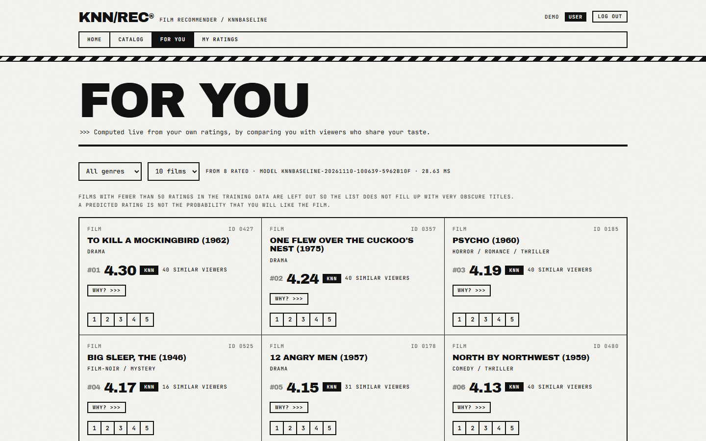
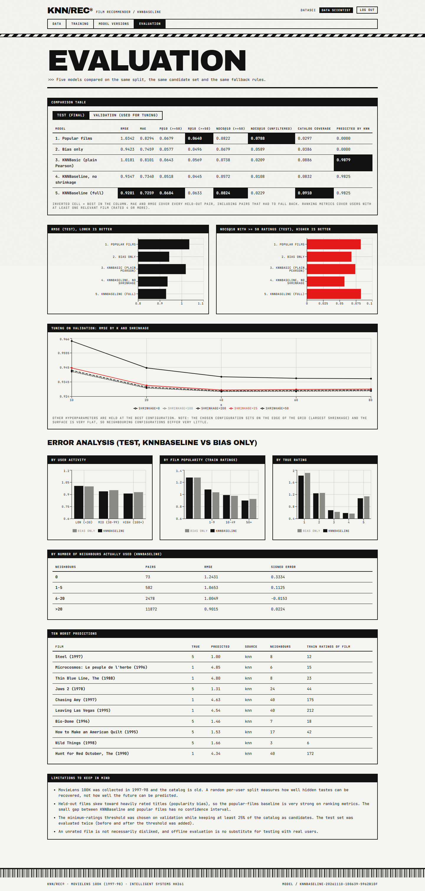
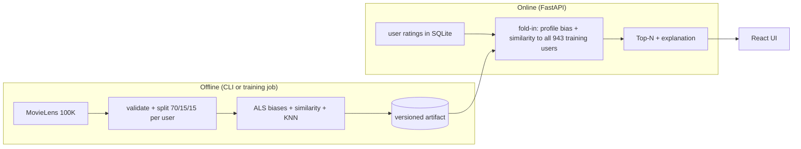

# KNN/REC: personalized film recommender (KNNBaseline)

[Tiếng Việt](README.vi.md) · [Project plan](PLAN.md) · [Original specification (vi)](desc.md)

A complete web system, from data pipeline to browser UI, that recommends films from your own ratings. It finds viewers with a taste like yours (user-based k-NN), after learning how generously each user rates and how well each film is rated overall (**KNNBaseline**: ALS-learned biases, Pearson-baseline similarity, shrinkage). Everything runs on real data, [MovieLens 100K](https://grouplens.org/datasets/movielens/100k/), and the recommendation is computed live inside the API, not precomputed.

Built for the *Intelligent Systems* course (HK261). The algorithm is implemented from scratch with NumPy (no recommender library), and covered by hand-computed tests.

| Recommendations with explanation | Data scientist: evaluation |
|---|---|
|  |  |

More screens are in [`docs/screenshots/`](docs/screenshots/).

## What you get

| Role | What they can do |
|---|---|
| **User** | Register, rate films (1-5), search the catalog, get Top-N recommendations, see *why* a film was recommended (score breakdown and the anonymous neighbours behind it), edit or remove ratings and watch the list change immediately. A brand-new user sees popular films (cold start) until they rate a few. |
| **Admin** | System overview (model in service, latency p50/p95, fallback rate), manage accounts (role, lock/unlock), hide films from the catalog and from all recommendations, preview recommendations for any MovieLens profile. |
| **Data scientist** | Data quality report and train/validation/test split, launch training jobs with chosen hyperparameters, browse immutable model versions and **hot-swap** the active one without a restart, compare five models, view tuning curves and error analysis. |

Permissions are enforced on the server, not just hidden in the UI.

## How it works



- **Baseline:** `b_ui = mu + b_u + b_i`, with `b_u` and `b_i` learned by ALS with regularization.
- **Neighbours:** Pearson similarity on the residuals `r - b`, damped by shrinkage when few films are shared. Prediction = baseline + similarity-weighted average of the neighbours' residuals; with fewer than `min_k` neighbours it falls back to the baseline.
- **Web users are not in the training data**, so each request *folds the user in*: it estimates the profile bias, computes similarity against all training users, predicts, removes rated films and applies a minimum-ratings threshold per film. Details in [`ml/models/foldin.py`](ml/models/foldin.py).
- **No leakage:** the split is per user with a fixed seed; biases, similarities and popularity come only from the train split; hyperparameters are chosen on validation; the test set is evaluated once per frozen configuration.

### Measured results (test split, frozen configuration)

| Model | RMSE | MAE | Recall@10 | NDCG@10 | Catalog coverage |
|---|---:|---:|---:|---:|---:|
| Popular films | 1.0342 | 0.8294 | 0.0640 | 0.0822 | 3.0% |
| Bias only | 0.9423 | 0.7459 | 0.0496 | 0.0679 | 3.9% |
| KNNBasic (plain Pearson) | 1.0181 | 0.8101 | 0.0569 | 0.0738 | 8.9% |
| KNNBaseline, no shrinkage | 0.9347 | 0.7340 | 0.0445 | 0.0572 | 8.3% |
| **KNNBaseline (full)** | **0.9281** | **0.7259** | 0.0633 | 0.0824 | 9.1% |

Ranking metrics use films with at least 50 training ratings as candidates (threshold chosen on validation). Honest reading: KNNBaseline predicts ratings best and recommends a more varied set of films, but on ranking it is **on par with** the popular-films baseline (the gap is within noise, and there is no confidence interval). Offline evaluation also favours popular films, because held-out films skew popular. Re-create these numbers with the commands below; the full tables and error analysis are on the *Evaluation* page.

## Quick start

**Requirements:** Python 3.11+, Node 20+, and internet access once to download MovieLens 100K (about 5 MB) from GroupLens. Developed and verified on Windows 11 with Python 3.12 and Node 24; the macOS/Linux commands below are the standard equivalents and have not been run on those systems.

```bash
git clone https://github.com/Kryslogem/knn-recommend.git
cd knn-recommend

# 1. Python environment
python -m venv .venv
#   activate it:  Windows PowerShell: .venv\Scripts\Activate.ps1
#                 Windows Git Bash:   source .venv/Scripts/activate
#                 macOS / Linux:      source .venv/bin/activate
python -m pip install -r backend/requirements.txt

# 2. Data: download, verify SHA-256, validate, split (seed 42)
python scripts/prepare_data.py

# 3. Train with the committed configuration and activate it (about 1 minute)
python scripts/train.py --activate

# 4. Database + three demo accounts (admin, datasci, demo)
python scripts/seed_db.py

# 5. Backend (terminal 1). API docs: http://127.0.0.1:8000/docs
python -m uvicorn backend.app.main:app --port 8000

# 6. Frontend (terminal 2). App: http://localhost:5173
cd frontend
npm install
npm run dev
```

Open <http://localhost:5173>. **Register** to try the user flow, or sign in as a demo account. `seed_db.py` generates random passwords for the demo accounts and a JWT secret, and writes them to `.env` (git-ignored, never printed): open `.env` and read `KNN_SEED_ADMIN_PASSWORD`, `KNN_SEED_DS_PASSWORD`, `KNN_SEED_USER_PASSWORD`. Usernames are `admin`, `datasci`, `demo`.

The data scientist's **Evaluation** page needs reports that you generate once:

```bash
python scripts/tune.py        # ~7 min: grid search on the validation split
python scripts/evaluate.py    # ~4 min: five models; runs the test split once per configuration
```

## Trying it as a user

1. Register, then rate at least 5 films on the onboarding screen.
2. Open **For you**: each card shows the predicted rating, its source (`KNN`, `Baseline` or `Popular`) and how many similar viewers support it. Press **Why?** for the breakdown `mu + b_user + b_item + neighbour term` and the anonymous neighbours.
3. Change a rating under **My ratings** and return to **For you**: the list is recomputed.

## Training and model versions

- `python scripts/train.py --activate` fits on the train split, evaluates on validation and saves an immutable version in `artifacts/models/<version>/` (`model.npz`, `meta.json`, `metrics.json`).
- As the data scientist you can also start a training job from the **Training** page (hyperparameters are validated), then **activate** the new version on **Model versions**. The server swaps the model in memory with no restart; a version that fails to load never replaces the working one.
- Hyperparameters live in [`configs/model.yaml`](configs/model.yaml) (generated by `scripts/tune.py`); the tuning grid is [`configs/grid.yaml`](configs/grid.yaml); data settings and the split are in [`configs/data.yaml`](configs/data.yaml).
- `python scripts/tune.py --only-threshold` re-chooses only the minimum-ratings threshold (about 40 s).

## API

Interactive docs at `/docs` (Swagger). Sign in with `POST /api/v1/auth/login` (`{"username","password"}`) and send `Authorization: Bearer <token>`. Errors always look like `{"detail": "...", "code": "..."}`.

| Area | Endpoints |
|---|---|
| Auth | `POST /auth/register`, `POST /auth/login`, `GET /auth/me` |
| Films | `GET /movies`, `GET /movies/{id}`, `GET /movies/{id}/prediction`, `GET /movies/popular`, `GET /genres` |
| Ratings | `GET /ratings/me`, `PUT /ratings/{movie_id}` (upsert), `DELETE /ratings/{movie_id}` |
| Recommendations | `GET /recommendations?n=&genre=`, `GET /recommendations/{movie_id}/explain` |
| Admin (`admin`) | `GET /admin/status`, `GET/PATCH /admin/users`, `GET/PATCH /admin/movies`, `GET /admin/recommendations/movielens/{id}` |
| Data scientist (`data_scientist`) | `GET /ds/data/report`, `GET /ds/data/split`, `POST/GET /ds/training-jobs`, `GET /ds/models`, `POST /ds/models/{id}/activate`, `GET /ds/evaluation/{comparison,tuning,errors}` |

## Configuration

Copy `.env.example` to `.env` (done automatically by `seed_db.py`). All variables are optional and use the `KNN_` prefix.

| Variable | Meaning | Default |
|---|---|---|
| `KNN_DATABASE_URL` | SQLAlchemy URL | `sqlite:///<repo>/knn.db` |
| `KNN_JWT_SECRET` | Token signing secret (generated by `seed_db.py`) | placeholder |
| `KNN_JWT_EXPIRE_MINUTES` | Token lifetime | `120` |
| `KNN_CORS_ORIGINS` | Allowed browser origins (JSON list) | `["http://localhost:5173"]` |
| `KNN_ARTIFACTS_DIR` | Where model versions are stored | `artifacts/models` |
| `KNN_SEED_*` | Usernames and passwords of the demo accounts | `admin` / `datasci` / `demo` |

**Before exposing this anywhere other than your own machine:** put it behind HTTPS, set a strong `KNN_JWT_SECRET`, change or remove the demo accounts, and add login rate limiting (not implemented). The "profile" model is pseudonymous: only a username and password are stored.

## Project layout

| Path | Contents |
|---|---|
| `ml/` | Algorithm and pipeline, independent of the web layer: `data/` (download, validate, split), `models/` (ALS, similarity, KNN, fold-in, artifacts), `eval/` (metrics, tuning, error analysis) |
| `backend/app/` | FastAPI app: auth and roles, routers, recommendation service, model registry, background training |
| `frontend/src/` | React + TypeScript + Tailwind UI, one set of pages per role |
| `scripts/` | `prepare_data`, `tune`, `evaluate`, `train`, `seed_db`, `benchmark`, `screenshots`, `demo_recommend` |
| `configs/` | Data, model and tuning configuration |
| `tests/`, `backend/tests/` | Algorithm, fold-in and API tests |
| `docs/` | Screenshots, latency benchmark, contribution table |
| `artifacts/`, `data/` | Generated at run time (models, reports, split data); not in git |

## Testing and measurement

```bash
python -m pytest                      # 112 tests: hand-computed algorithm checks, leakage, fold-in, API (temporary DB)
python scripts/benchmark.py           # with the backend running: end-to-end latency, writes docs/benchmark.md
node scripts/screenshots.mjs          # UI screenshots (needs backend, frontend, Chrome or Edge)
python scripts/demo_recommend.py --ratings "1:5,50:5,100:2"   # recommendations from the command line
```

Measured Top-10 latency (300 profiles, real HTTP, same machine): **p50 50 ms, p95 70 ms**, against a 2-second target. Machine details are in [`docs/benchmark.md`](docs/benchmark.md).

## Troubleshooting

| Symptom | Fix |
|---|---|
| `503 model_not_loaded` or an empty *For you* page | No model is active. Run `python scripts/train.py --activate` and restart the backend, or activate a version on the *Model versions* page. |
| *Report not available yet* on the Evaluation page | Run `python scripts/tune.py` and `python scripts/evaluate.py` once. |
| Every request takes about 2 seconds | Use `127.0.0.1` instead of `localhost` for the backend URL. On Windows, clients try IPv6 first and wait about 2 s before falling back. |
| SSL error while downloading the dataset (Windows) | `pip install -r backend/requirements.txt` includes `truststore`, which makes Python use the Windows certificate store. Re-run the command. |
| I forgot the demo passwords | Open `.env` (keys `KNN_SEED_*_PASSWORD`). |
| Start over with a clean database | `python scripts/seed_db.py --reset` (deletes all web accounts and ratings). |
| `evaluate.py` refuses to run | The test split was already evaluated for this configuration. Use `--force` only if you accept re-running it. |

## Data, licensing and limitations

- **Data:** MovieLens 100K, from GroupLens Research. It is **not** redistributed in this repository: `prepare_data.py` downloads it and checks its SHA-256. Read the [dataset terms](https://files.grouplens.org/datasets/movielens/ml-100k-README.txt) before use. Please cite: F. Maxwell Harper and Joseph A. Konstan, *The MovieLens Datasets: History and Context*, ACM TiiS 5(4), 2015.
- **Code:** MIT, see [`LICENSE`](LICENSE).
- **Limits:** the data is from 1997-98 and the catalog is old; a random per-user split measures how well hidden tastes are recovered, not future behaviour; an unrated film is not necessarily disliked; a predicted rating is not the probability that someone will like a film; and a web user's own ratings are used for their recommendations but are not added to the training data until a new model version is trained.
