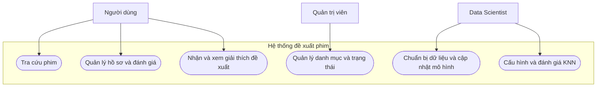
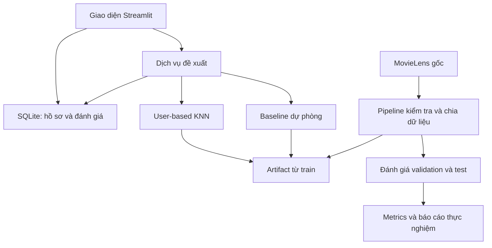

# HỆ THỐNG ĐỀ XUẤT PHIM CÁ NHÂN HÓA BẰNG KNN

**Môn học:** Hệ thống thông minh (Intelligent Systems)  
**Tên tiếng Anh:** Personalized Movie Recommendation System Using K-Nearest Neighbors  
**Thuật toán chính:** User-based KNN Collaborative Filtering  
**Dataset đề xuất:** MovieLens 100K  
**Thời gian dự kiến:** 8 tuần; có phương án rút gọn còn 7 tuần  
**Ngày lập tài liệu:** 19/10/2026  
**Trạng thái:** Đặc tả dự án và kế hoạch triển khai, chưa phải báo cáo kết quả thực nghiệm.

> Tài liệu này mô tả sản phẩm dự kiến, thiết kế thuật toán, quy trình đánh giá và các đầu việc cần hoàn thành. Các số liệu về chất lượng mô hình phải được bổ sung sau khi chạy thực nghiệm. Những ví dụ về điểm dự đoán trong tài liệu chỉ dùng để giải thích, không phải kết quả đã đo.

## 1. Bối cảnh và vấn đề

Khi có nhiều phim để lựa chọn, người xem có thể mất thời gian tìm một bộ phim phù hợp. Danh sách phim phổ biến hoặc có điểm trung bình cao cung cấp cùng một gợi ý cho nhiều người, trong khi sở thích cá nhân có thể khác nhau.

Dự án xây dựng ứng dụng đề xuất phim dựa trên lịch sử đánh giá. Hệ thống tìm những người dùng có cách đánh giá tương đồng với người đang sử dụng, sau đó tận dụng đánh giá của họ để đề xuất phim mà người đó chưa đánh giá.

Câu hỏi trung tâm của dự án:

> Từ điểm đánh giá của một người dùng và lịch sử đánh giá của cộng đồng, có thể chọn ra 10 phim phù hợp với người đó bằng KNN như thế nào?

Trong MVP, “chưa đánh giá” được dùng làm đại diện cho “chưa biết đã xem hay chưa”. Không khẳng định người dùng chưa xem một phim chỉ vì họ chưa chấm điểm.

## 2. Mục tiêu và tiêu chí hoàn thành

### 2.1. Mục tiêu

- Xây dựng MVP có giao diện cho phép tìm phim, chấm điểm và nhận đề xuất cá nhân hóa.
- Tích hợp KNN thực sự vào luồng sử dụng; kết quả được tính từ dữ liệu và hồ sơ người dùng.
- Dùng dữ liệu đánh giá thực, có nguồn rõ ràng; không tạo dữ liệu mô phỏng để huấn luyện hoặc đánh giá.
- Đánh giá KNN so với baseline bằng cùng một quy trình thực nghiệm.
- Thể hiện đầy đủ yêu cầu, tác nhân, use case, thiết kế, kiểm thử và tài liệu vận hành theo rubric.

### 2.2. Tiêu chí hoàn thành MVP

1. Người dùng tìm được phim và lưu được đánh giá từ 1 đến 5 sao.
2. Hệ thống tạo tối đa 10 đề xuất hợp lệ, loại các phim đã được người dùng đánh giá.
3. Có phương án dự phòng khi người dùng chưa đủ lịch sử hoặc KNN không đủ láng giềng.
4. Có quy trình tái lập việc chuẩn bị dữ liệu, lựa chọn cấu hình và đánh giá.
5. Có báo cáo so sánh baseline, phân tích lỗi và giới hạn; không đặt trước một mức điểm chất lượng chưa được kiểm chứng.
6. Người khác chạy được hệ thống theo README và thực hiện được kịch bản demo.

## 3. Phạm vi

### 3.1. Trong phạm vi

- Nhập MovieLens 100K và kiểm tra tính hợp lệ của dữ liệu.
- Tìm kiếm theo tên, lọc theo thể loại, xem thông tin cơ bản của phim.
- Chọn hồ sơ lịch sử hoặc tạo hồ sơ mới trong bản demo.
- Thêm, sửa đánh giá cá nhân; lưu lịch sử trong SQLite.
- Đề xuất Top 10 phim bằng User-based KNN.
- Hiển thị điểm dự đoán, số láng giềng hỗ trợ và lý do khái quát của đề xuất.
- Trang dành cho Data Scientist để xem phiên bản dữ liệu, cấu hình và kết quả đánh giá.
- Baseline phim phổ biến, kiểm thử và tài liệu đầy đủ.

### 3.2. Ngoài phạm vi MVP

- Phát trực tuyến phim, mua vé hoặc thanh toán.
- Dự đoán từ ảnh khuôn mặt, giọng nói hoặc dữ liệu mạng xã hội.
- Tích hợp nhiều nền tảng xem phim.
- Hạ tầng phục vụ hàng triệu người dùng hoặc mô hình deep learning.
- Tự động lấy poster, trailer và nội dung phim từ dịch vụ bên ngoài. Có thể bổ sung sau nếu còn thời gian và có nguồn hợp lệ.

## 4. Đầu vào và đầu ra

### 4.1. Đầu vào khi xây dựng mô hình

Mỗi bản ghi tương tác có cấu trúc:

| Trường | Ý nghĩa | Vai trò |
|---|---|---|
| `user_id` | Mã người dùng | Ghép các đánh giá thuộc cùng người |
| `movie_id` | Mã phim | Liên kết đánh giá với phim |
| `rating` | Điểm 1–5 | Tín hiệu sở thích chính |
| `timestamp` | Thời điểm đánh giá | Phục vụ kiểm tra và các cách chia theo thời gian |

Thông tin tên và thể loại phim được ghép qua `movie_id`. Mã người dùng và mã phim là định danh, không dùng khoảng cách số học giữa các mã để đo sở thích.

### 4.2. Đầu vào khi sử dụng ứng dụng

- Hồ sơ người dùng được chọn hoặc tạo mới.
- Một số phim người dùng đã chấm điểm.
- Số lượng phim muốn nhận, mặc định 10.
- Bộ lọc thể loại tùy chọn.

Ví dụ minh họa đầu vào:

| Phim | Điểm người dùng |
|---|---:|
| Toy Story (1995) | 5 |
| Star Wars (1977) | 5 |
| Fargo (1996) | 2 |

Ví dụ trên chỉ diễn tả thao tác nhập. Không dùng ba bản ghi minh họa này thay cho dataset thực.

### 4.3. Đầu ra khi sử dụng ứng dụng

Một danh sách có thứ tự, mỗi phần tử gồm:

| Trường | Ý nghĩa |
|---|---|
| `rank` | Thứ hạng đề xuất |
| `movie_id`, `title`, `genres` | Thông tin phim |
| `predicted_rating` | Điểm ước lượng người dùng có thể chấm; có thể trống với fallback |
| `support_count` | Số láng giềng thực sự đóng góp dự đoán |
| `recommendation_source` | KNN hoặc baseline dự phòng |
| `explanation` | Giải thích dựa trên cách hệ thống đã tính |

Điểm dự đoán 4,5/5 không có nghĩa là xác suất thích phim bằng 90%. Đây là giá trị ước lượng trên thang điểm đánh giá.

### 4.4. Phân biệt dữ liệu lịch sử và hồ sơ mới

Nhóm phát triển chuẩn bị dataset từ trước. Người dùng cuối không cần tải dataset; họ chỉ chọn phim và chấm điểm. Người mới chưa chấm phim được xem gợi ý phổ biến và được mời đánh giá khoảng 5–10 phim để khởi tạo sở thích. Ngưỡng chính thức sẽ được kiểm tra qua thực nghiệm, không coi số lượng này là bảo đảm chất lượng.

## 5. Dataset và cách truy cập

### 5.1. Dataset chính: MovieLens 100K

Theo README chính thức của GroupLens:

- 100.000 lượt đánh giá từ 943 người dùng trên 1.682 phim.
- Điểm đánh giá từ 1 đến 5; mỗi người có ít nhất 20 lượt đánh giá.
- Dữ liệu được thu thập trong giai đoạn 1997–1998.

Nguồn:

- Trang chính thức: <https://grouplens.org/datasets/movielens/100k/>
- Tải ZIP: <https://files.grouplens.org/datasets/movielens/ml-100k.zip>
- README gốc: <https://files.grouplens.org/datasets/movielens/ml-100k-README.txt>
- Bản sao tham khảo trên Hugging Face: <https://huggingface.co/datasets/includeno/movielens-100k/tree/main>

Ưu tiên tải từ GroupLens để thống nhất với tài liệu gốc. Đã đối chiếu README chính thức và danh sách file trên Hugging Face; chưa tải hoặc kiểm chứng toàn bộ byte của bản sao trong giai đoạn lập đặc tả.

### 5.2. File cần dùng

| File | Nội dung | Mục đích |
|---|---|---|
| `u.data` | `user_id`, `item_id`, `rating`, `timestamp`, phân cách tab | Tạo ma trận và chia dữ liệu |
| `u.item` | Mã, tên, ngày phát hành, URL IMDb, 19 cờ thể loại; phân cách bằng dấu `|` | Hiển thị danh mục và lọc phim |
| `u.genre` | Danh sách thể loại | Diễn giải thể loại |
| `u.info` | Thống kê quy mô | Đối chiếu dữ liệu nhập |
| `u1.base`, `u1.test` và các cặp tương tự | Các tập chia sẵn | Phương án đánh giá tham khảo |

Định dạng `u.item` cần được kiểm tra khi đọc, đặc biệt dấu phân cách, số cột và encoding. Không cần dùng thông tin nhân khẩu học trong `u.user` cho mô hình KNN của MVP.

### 5.3. Kiểm tra sau khi tải

1. Lưu ngày tải, URL, phiên bản và checksum SHA-256 của file gốc.
2. Kiểm tra số lượt đánh giá, số người dùng và số phim với README.
3. Kiểm tra miền điểm, định danh liên kết, giá trị thiếu và cặp người dùng–phim trùng.
4. Lưu báo cáo kiểm tra; không âm thầm xóa hoặc thay dữ liệu.
5. Nếu cần xử lý trùng, ghi rõ quy tắc trước khi chia tập.

### 5.4. Điều kiện sử dụng và giới hạn

README cho phép sử dụng nghiên cứu theo các điều kiện đi kèm, yêu cầu ghi nhận nguồn và hạn chế phân phối lại dữ liệu. Repo bàn giao nên chứa hướng dẫn tải thay vì tự đính kèm dataset. Điều kiện gốc của GroupLens cần được đọc khi triển khai; nhãn giấy phép của bản sao không thay thế điều kiện gốc.

Dữ liệu có phim cũ và nhóm người dùng cụ thể, không đại diện cho toàn bộ sở thích khán giả Việt Nam hiện nay. Dataset không cung cấp đầy đủ poster hoặc thông tin nơi xem phim. Hệ thống là MVP chứng minh phương pháp trên dữ liệu này.

### 5.5. Phương án thay thế

MovieLens Latest Small có 100.836 đánh giá của 610 người dùng trên 9.742 phim trong bản phát hành ngày 26/9/2018. Các file CSV thuận tiện hơn nhưng cần cố định bản dùng vì đây là development dataset.

- Trang tải: <https://grouplens.org/datasets/movielens/latest/>
- README: <https://files.grouplens.org/datasets/movielens/ml-latest-small-README.html>

Dự án chỉ dùng một dataset chính để tránh phát sinh ghép dữ liệu và thay đổi thiết kế giữa kỳ.

## 6. Stakeholder và tác nhân

| Vai trò | Nhu cầu hoặc trách nhiệm |
|---|---|
| Người xem phim | Nhận gợi ý phù hợp, thao tác chấm điểm đơn giản |
| Quản trị viên | Quản lý danh mục, kiểm tra dữ liệu và trạng thái ứng dụng |
| Data Scientist | Chuẩn bị dữ liệu, chọn K, cấu hình, đánh giá, phân tích lỗi, cập nhật mô hình |
| Nhóm phát triển | Xây dựng ứng dụng, tích hợp, kiểm thử và bảo trì |
| Giảng viên/người đánh giá | Kiểm chứng thuật toán, quy trình dữ liệu, khả năng chạy và đóng góp cá nhân |

Ba tác nhân trực tiếp của hệ thống là Người dùng, Quản trị viên và Data Scientist. Nhóm phát triển và giảng viên là stakeholder, không nhất thiết đưa vào use-case diagram.

## 7. Yêu cầu hệ thống

### 7.1. Yêu cầu chức năng

| Mã | Yêu cầu | Điều kiện nghiệm thu |
|---|---|---|
| FR01 | Tìm và lọc phim | Hiển thị đúng phim phù hợp tên/thể loại |
| FR02 | Quản lý hồ sơ demo | Tạo được hồ sơ mới; phân biệt với ID lịch sử |
| FR03 | Thêm/sửa điểm | Lưu điểm 1–5; cùng hồ sơ và phim chỉ có một đánh giá hiện hành |
| FR04 | Xem lịch sử | Hiển thị đúng điểm của hồ sơ hiện tại |
| FR05 | Đề xuất cá nhân hóa | Chạy KNN, loại phim đã đánh giá, trả tối đa N phim |
| FR06 | Giải thích đề xuất | Nêu nguồn KNN/fallback và mức hỗ trợ đúng dữ liệu tính toán |
| FR07 | Xử lý thiếu lịch sử | Hiển thị baseline và hướng dẫn bổ sung đánh giá |
| FR08 | Chuẩn bị/cập nhật mô hình | Data Scientist chạy pipeline và theo dõi phiên bản |
| FR09 | Đánh giá mô hình | Xuất metrics, cấu hình và báo cáo baseline |
| FR10 | Kiểm tra đầu vào | Từ chối điểm ngoài miền, phim không tồn tại hoặc tham số không hợp lệ |

### 7.2. Yêu cầu phi chức năng

| Mã | Yêu cầu | Cách kiểm chứng |
|---|---|---|
| NFR01 | Tái lập thực nghiệm | Cố định seed, phiên bản dữ liệu, cấu hình và thư viện |
| NFR02 | Phản hồi nhanh | Mục tiêu Top 10 trong khoảng 2 giây sau khi nạp mô hình trên máy demo; đo và báo cáo cấu hình máy |
| NFR03 | Dữ liệu nhất quán | Ràng buộc đánh giá duy nhất, kiểm tra lưu và đọc lại |
| NFR04 | Dễ sử dụng | Hoàn thành luồng chọn phim–chấm điểm–nhận gợi ý qua giao diện |
| NFR05 | Phân vai rõ | Chức năng cập nhật/đánh giá mô hình thuộc khu vực quản trị hoặc lệnh riêng |
| NFR06 | Dễ chạy | README chỉ rõ môi trường, dữ liệu và các bước khởi động |
| NFR07 | Bảo vệ hồ sơ | Dùng ID giả danh; không cần thu tên thật hoặc thông tin liên hệ |

Nếu triển khai đa người dùng công khai, phải bổ sung xác thực và kiểm tra quyền ở phía xử lý. Bộ chọn hồ sơ trong bản demo không được coi là cơ chế xác thực.

## 8. Use-case diagram

Sơ đồ sau biểu diễn tác nhân và các nhóm chức năng bằng Mermaid flowchart, không phải ký pháp UML use case đầy đủ. Khi nộp báo cáo có thể chuyển các nhóm này sang sơ đồ UML chuẩn nếu giảng viên yêu cầu.



## 9. Hai use case chính

### UC01 — Nhận đề xuất cá nhân hóa

- **Tác nhân:** Người dùng.
- **Tiền điều kiện:** Có hồ sơ; dữ liệu và mô hình đã nạp thành công.
- **Kích hoạt:** Người dùng chọn “Đề xuất phim”.
- **Luồng chính:**
  1. Hệ thống đọc các điểm hiện tại của hồ sơ.
  2. Kiểm tra số đánh giá và mức giao nhau với dữ liệu lịch sử.
  3. Tính tương đồng, chọn láng giềng hợp lệ.
  4. Ước lượng điểm các phim ứng viên chưa đánh giá.
  5. Áp dụng bộ lọc, sắp xếp và trả tối đa 10 phim.
  6. Hiển thị điểm dự đoán, mức hỗ trợ và nguồn đề xuất.
- **Luồng thay thế:** Không đủ láng giềng thì dùng fallback; bộ lọc quá hẹp thì trả ít hơn 10 và thông báo.
- **Hậu điều kiện:** Người dùng nhận danh sách phù hợp với lịch sử hiện tại; không tạo phim hoặc đánh giá giả để lấp danh sách.

### UC02 — Cấu hình và đánh giá mô hình

- **Tác nhân:** Data Scientist.
- **Tiền điều kiện:** Dataset đã được kiểm tra và các tập train/validation/test đã cố định.
- **Luồng chính:**
  1. Chọn tập cấu hình K, độ tương đồng, ngưỡng giao nhau và cách tổng hợp điểm.
  2. Tạo artifact chỉ từ train.
  3. Chạy và so sánh cấu hình trên validation.
  4. Chốt cấu hình theo tiêu chí đã định.
  5. Đánh giá test một lần cho cấu hình cuối theo quy trình đã chốt.
  6. Lưu metrics, cấu hình, seed, phiên bản dữ liệu và phân tích lỗi.
- **Luồng thay thế:** Dữ liệu không hợp lệ thì dừng và xuất lỗi; cấu hình không tạo được dự đoán phải ghi coverage và fallback.
- **Hậu điều kiện:** Có kết quả thực nghiệm tái lập; không sử dụng test để tiếp tục chọn K.

## 10. Thuật toán KNN đề xuất

### 10.1. Biểu diễn dữ liệu

Ma trận R có hàng là người dùng, cột là phim và giá trị là điểm đánh giá. Các ô chưa đánh giá được quản lý bằng mask hoặc cấu trúc sparse; không hiểu là người dùng chấm 0 sao.

KNN là phương pháp dựa trên dữ liệu lưu trữ. Bước “huấn luyện” chủ yếu là tạo ma trận, các thống kê và cấu trúc tìm láng giềng, không học trọng số qua nhiều epoch.

### 10.2. Độ tương đồng

Cấu hình ban đầu: Pearson trên các phim hai người cùng đánh giá; chỉ nhận láng giềng có đủ phim chung và độ tương đồng dương. Nếu phương sai bằng 0 hoặc không đủ giao nhau, cặp đó không đủ điều kiện tính tương đồng theo cách này.

Cấu hình đối chiếu: cosine trên vector điểm đã căn giữa theo người dùng, chỉ tính trên các phim chung. Cần ghi rõ quy ước vì cách này khác cosine trực tiếp trên toàn bộ ma trận điền 0.

Ngưỡng số phim chung và hệ số giảm trọng số cho cặp ít giao nhau được chọn trên validation. Tránh kết luận hai người rất giống nhau chỉ từ một phim cùng chấm.

### 10.3. Dự đoán điểm

Với người dùng u và phim i:

```text
r_hat(u,i) = mean(u)
           + sum[sim(u,v) * (r(v,i) - mean(v))]
             / sum[abs(sim(u,v))]
```

Trong đó v thuộc tập tối đa K người giống u nhất, đủ điều kiện và đã đánh giá phim i. Trung bình được tính từ dữ liệu hiện có của người đó trong train hoặc hồ sơ được phép sử dụng tại lúc suy luận.

- Chặn kết quả về miền 1–5.
- Không có mẫu hỗ trợ hoặc mẫu số bằng 0: đánh dấu không đủ cơ sở dự đoán và chuyển fallback.
- `support_count` là số người thực sự tham gia công thức, không mặc định bằng K.
- Khi demo hồ sơ có sẵn, loại chính hồ sơ đó khỏi tập láng giềng.

### 10.4. Tạo danh sách Top N

1. Lấy danh mục phim đủ điều kiện.
2. Loại phim người dùng đã đánh giá.
3. Áp dụng bộ lọc nếu có.
4. Tính điểm KNN và sắp xếp giảm dần; dùng quy tắc phá hòa cố định.
5. Lấy tối đa N phim; nếu thiếu, bổ sung baseline và gắn nhãn rõ.

K láng giềng và N phim đề xuất là hai tham số khác nhau. Ví dụ K = 20 vẫn có thể trả N = 10 phim.

### 10.5. Baseline và cold start

Baseline chính là xếp hạng phim theo số đánh giá từ 4 sao trở lên trong train; phá hòa bằng điểm trung bình train rồi mã phim. Baseline cũng loại các phim người dùng đã đánh giá và dùng cùng bộ lọc.

Với người mới, baseline được hiển thị trước. Sau khi nhận thêm đánh giá thật, hệ thống thử tạo đề xuất KNN. Việc người dùng thật chấm điểm khi demo là đầu vào vận hành, không thay thế bộ test chuẩn.

### 10.6. Không gian thử nghiệm

- K: 10, 20, 40, 60.
- Pearson và cosine căn giữa trên phần giao nhau.
- Ngưỡng phim chung, ví dụ 2, 3, 5.
- Có/không giảm trọng số do số phim chung ít.

Giới hạn số tổ hợp theo thời gian thực tế. Tiêu chí chọn chính dự kiến là NDCG@10 trên validation, xét thêm Recall@10, coverage và thời gian phản hồi.

## 11. Thiết kế hệ thống

### 11.1. Công nghệ dự kiến

| Thành phần | Lựa chọn | Lý do |
|---|---|---|
| Ngôn ngữ | Python | Thuận tiện cho dữ liệu và thuật toán |
| Giao diện MVP | Streamlit | Xây luồng sử dụng và dashboard nhanh |
| Xử lý dữ liệu | pandas, NumPy, SciPy | Đọc file, tính toán và ma trận sparse |
| Thực nghiệm | scikit-learn và mã KNN của nhóm | Tiện ích chia dữ liệu/metrics; kiểm soát phép tính láng giềng |
| Lưu hồ sơ | SQLite | Đơn giản, đủ cho MVP |
| Đồ thị | Matplotlib hoặc Plotly | Báo cáo phân bố và kết quả |
| Quản lý mã | Git | Theo dõi thay đổi và đóng góp |

Không bắt buộc có API riêng nếu giao diện đã chạy đầy đủ. Chỉ bổ sung FastAPI khi nhóm cần tách frontend/backend và còn đủ thời gian. Phiên bản thư viện phải được chốt khi triển khai.

### 11.2. Kiến trúc



Giao diện gọi một dịch vụ đề xuất dùng chung cho demo và kiểm thử tích hợp. Pipeline offline chuẩn bị dữ liệu và artifact; đánh giá mới trong ứng dụng được đưa vào hồ sơ truy vấn. Bản MVP không tự động đưa mọi người dùng mới vào cộng đồng tham chiếu nếu chưa chạy cập nhật mô hình.

### 11.3. Mô hình dữ liệu tối thiểu

| Bảng/Artifact | Trường chính | Ghi chú |
|---|---|---|
| `users` | `user_id`, `profile_type`, `created_at` | Phân biệt hồ sơ lịch sử và hồ sơ mới |
| `movies` | `movie_id`, `title`, `release_date`, `genres` | Nhập từ dataset |
| `ratings` | `user_id`, `movie_id`, `rating`, `timestamp`, `source` | Ràng buộc duy nhất theo người và phim |
| `model_versions` | `version_id`, `config`, `data_hash`, `created_at` | Theo dõi cấu hình và nguồn |
| Artifact mô hình | Ma trận train, mask, mapping, trung bình | Lưu cùng phiên bản |
| Artifact đánh giá | Split IDs, seed, metrics, nhật ký | Tách khỏi dữ liệu vận hành |

Đánh giá vận hành được lưu riêng hoặc có trường nguồn để không vô tình trộn vào test. Khi thay đổi điểm, phải làm mới cache đề xuất của hồ sơ.

## 12. Quy trình dữ liệu và chống leakage

### 12.1. Quy trình chia tập chính

- Dùng cách chia theo từng người dùng cho kịch bản warm start: khoảng 70% train, 15% validation, 15% test, seed cố định và quy tắc làm tròn rõ ràng.
- Mỗi người dùng được đánh giá phải có lịch sử train đủ để tạo hồ sơ. Đây là chia tương tác, không chia toàn bộ người dùng thành các nhóm độc lập.
- Dùng phân hoạch ngẫu nhiên cố định cho thực nghiệm chính; ghi rõ nó đánh giá khả năng khôi phục sở thích bị giữ lại, không chứng minh khả năng dự báo tương lai theo thời gian.
- Nếu thử chia thời gian, trình bày riêng và không trộn kết quả giữa hai quy trình.

### 12.2. Nguyên tắc bắt buộc

1. Chia tập trước khi dựng ma trận, tính trung bình, tính tương đồng và thống kê baseline.
2. Trong validation và test, hồ sơ truy vấn chỉ dùng đánh giá train; không dùng điểm của tương tác đang được dự đoán.
3. Chọn K, ngưỡng và cách tính trên validation. Test chỉ dùng cho đánh giá cuối sau khi chốt.
4. Việc lọc phim theo tần suất đánh giá chỉ được tính từ train. Phải công bố tác động của lọc tới coverage.
5. ID hoặc phim không có hỗ trợ trong train phải được ghi nhận và xử lý fallback; không âm thầm loại khỏi kết quả chung.
6. Ghi rõ pipeline đang đánh giá mô hình thuần KNN hay toàn bộ hệ thống có fallback.

Các tập chia sẵn của MovieLens là lựa chọn khác, không đồng thời trộn với cách chia chính. Nếu dùng `u1.base/u1.test`, cần tách validation từ `u1.base` và mô tả lại toàn bộ quy trình.

## 13. Thiết kế đánh giá

### 13.1. Đánh giá danh sách đề xuất

- N cố định bằng 10; ký hiệu láng giềng là K để tránh nhầm.
- Phim liên quan: phim trong tập validation/test được người dùng chấm từ 4 sao trở lên.
- Tập ứng viên: tất cả phim trong danh mục chưa được người đó đánh giá ở train, không chỉ vài phim âm được lấy mẫu.
- Tính Precision@10, Recall@10 và NDCG@10 theo cùng quy tắc cho baseline và KNN.
- Chỉ tính Recall/NDCG trên nhóm có ít nhất một phim liên quan trong tập đánh giá; công bố số người bị loại vì không có nhãn liên quan và báo cáo coverage riêng.
- Phim không có nhãn quan sát không được hiểu là chắc chắn không thích; đây là giới hạn của đánh giá offline trên phản hồi thưa.

| Chỉ số | Ý nghĩa |
|---|---|
| Precision@10 | Tỷ lệ phim liên quan trong 10 đề xuất |
| Recall@10 | Tỷ lệ phim liên quan bị giữ lại được tìm thấy trong Top 10 |
| NDCG@10 | Mức độ đưa phim liên quan lên các vị trí đầu |
| User coverage | Tỷ lệ người nhận được đề xuất; tách KNN thuần và toàn hệ thống |
| Catalog coverage | Tỷ lệ phim từng xuất hiện trong các danh sách đề xuất |

Nếu danh sách ngắn hơn 10, vẫn dùng mẫu số 10 cho Precision@10 và ghi nhận độ dài thực. Quy tắc này cần giữ nhất quán giữa các mô hình.

### 13.2. Đánh giá dự đoán điểm

Tính MAE và RMSE trên các đánh giá bị giữ lại. Báo cáo:

- Kết quả toàn hệ thống bao gồm fallback dự đoán điểm, nếu thiết kế có fallback điểm.
- Kết quả KNN trên các trường hợp có hỗ trợ và tỷ lệ trường hợp đó.
- Baseline dự đoán điểm riêng: trung bình người dùng từ train; không có lịch sử thì dùng trung bình toàn train.

Không gán điểm giả cho các gợi ý phổ biến chỉ để tính RMSE. Baseline xếp hạng và baseline dự đoán điểm phục vụ hai phép đo khác nhau.

### 13.3. Phân tích lỗi và kết quả cần xuất

- KNN so với baseline; chất lượng thay đổi theo K.
- Người có ít/nhiều lịch sử; phim phổ biến/ít người đánh giá.
- Trường hợp không đủ giao nhau hoặc sở thích khó tìm láng giềng.
- Tốc độ trên máy demo và ảnh hưởng của cache.
- Ví dụ dự đoán sai để giải thích giới hạn, không chỉ chọn ví dụ thành công.

Bảng kết quả chỉ điền sau thực nghiệm:

| Cấu hình | MAE | RMSE | Precision@10 | Recall@10 | NDCG@10 | Coverage |
|---|---|---|---|---|---|---|
| Baseline | Chưa đo | Chưa đo | Chưa đo | Chưa đo | Chưa đo | Chưa đo |
| KNN được chọn | Chưa đo | Chưa đo | Chưa đo | Chưa đo | Chưa đo | Chưa đo |

Không bảo đảm KNN sẽ thắng baseline ở mọi chỉ số. Nếu không thắng, cần phân tích dữ liệu, độ thưa, cấu hình và trade-off thay vì sửa quy trình để tạo kết quả đẹp.

## 14. Kiểm thử hệ thống

| Tình huống | Kết quả mong đợi |
|---|---|
| Điểm ngoài 1–5 hoặc sai kiểu | Từ chối, thông báo rõ |
| Mã phim không tồn tại | Không lưu; báo lỗi hợp lệ |
| Sửa điểm cùng một phim | Cập nhật bản ghi hiện hành, không tạo trùng |
| Người dùng chưa có điểm | Hiển thị baseline và hướng dẫn khởi tạo |
| Không có láng giềng hợp lệ | Fallback có nhãn nguồn |
| Phim đã đánh giá | Không xuất hiện trong danh sách đề xuất |
| Bộ lọc không còn phim | Thông báo không có kết quả hoặc trả ít hơn N |
| Thay đổi điểm | Danh sách dùng hồ sơ mới, không dùng cache cũ |
| Nạp lại ứng dụng | Đánh giá đã lưu còn tồn tại |
| Tập dữ liệu thiếu file/sai cấu trúc | Dừng bước import và báo file/cột lỗi |
| Pipeline đánh giá | Không đọc điểm validation/test vào hồ sơ train |

Kiểm tra thuật toán bằng vài phép tính tay nhỏ để đối chiếu similarity, chọn láng giềng và công thức điểm. Dữ liệu nhỏ phục vụ unit test không được dùng thay dataset thực hoặc báo cáo thành kết quả ML.

## 15. Kế hoạch 8 tuần

| Tuần | Công việc | Sản phẩm kiểm chứng được |
|---|---|---|
| 1 | Chốt phạm vi; tải và kiểm tra dataset; xác định stakeholder, yêu cầu; phân công | Đề cương, nguồn/checksum dữ liệu, bảng yêu cầu, phân công |
| 2 | Use-case diagram; 2 use case chính; kiến trúc, dữ liệu, giao diện; dựng khung repo | Bộ thiết kế, sơ đồ, phác thảo UI, khung ứng dụng |
| 3 | EDA; xử lý dữ liệu; cố định split/seed; baseline; quy tắc metrics và ứng viên | Pipeline tái lập, thống kê, split manifest, kết quả baseline |
| 4 | Cài KNN; thử K và similarity; chọn cấu hình trên validation; kiểm tra phép tính | Mô hình có thể gọi từ mã ứng dụng, bảng validation |
| 5 | Tích hợp giao diện, SQLite, đánh giá mới, đề xuất, giải thích và fallback | MVP chạy được từ đầu đến cuối |
| 6 | Đánh giá test cấu hình cuối; kiểm thử; phân tích lỗi, coverage, tốc độ; sửa lỗi tích hợp | Báo cáo thực nghiệm và kiểm thử với kết quả thực |
| 7 | Hoàn thiện giao diện; viết PDF/README; hướng dẫn dữ liệu; đóng góp và AI disclosure | Bản ổn định, báo cáo gần hoàn chỉnh, tài liệu chạy |
| 8 | Chạy môi trường sạch; hoàn thiện slide; diễn tập demo/Q&A; đóng gói | Bộ nộp hoàn chỉnh và demo dự phòng |

**Nếu chỉ có 7 tuần:** gộp tuần 7–8; viết báo cáo từ tuần 2 và cập nhật từng tuần. Không cắt bước chống leakage, đánh giá hoặc kiểm thử tích hợp.

**Mốc kiểm soát:** hết tuần 3 có baseline; hết tuần 4 KNN hoạt động; hết tuần 5 có MVP; hết tuần 6 khóa kết quả thực nghiệm; tuần cuối ưu tiên sửa lỗi và trình bày.

## 16. Phân công nhóm dự kiến

Chưa cố định số thành viên. Các trách nhiệm có thể gộp nhưng phải có người phụ trách và người rà soát:

| Mảng | Trách nhiệm |
|---|---|
| Phân tích và thiết kế | Yêu cầu, use case, kiến trúc, tính nhất quán tài liệu |
| Data Scientist/ML | Nguồn dữ liệu, pipeline, KNN, đánh giá và phân tích lỗi |
| Ứng dụng | Giao diện, SQLite, dịch vụ đề xuất, cache |
| QA và tài liệu | Kiểm thử, README, báo cáo, slide và kịch bản demo |

Lưu bằng chứng đóng góp qua commit, task và phần việc. Mỗi thành viên cần hiểu luồng dữ liệu và thuật toán để trả lời Q&A, kể cả khi không trực tiếp viết toàn bộ mô hình.

## 17. Đối chiếu rubric và sản phẩm bàn giao

| Nhóm tiêu chí | Điểm | Bằng chứng dự kiến |
|---|---:|---|
| Problem & requirements | 10 | Bài toán, phạm vi, stakeholder có Data Scientist, yêu cầu chức năng/phi chức năng |
| Analysis & design | 15 | Use-case diagram, 1–2 mô tả use case, kiến trúc, data flow và UI |
| Data & ML workflow | 15 | Nguồn dữ liệu thực, tiền xử lý, split, chống leakage, workflow |
| Algorithm & evaluation | 25 | Giải thích KNN, cài đặt đúng, metrics, baseline, phân tích lỗi |
| System & integration | 25 | MVP chạy được, thuật toán tích hợp thật, kiểm thử và đầu vào lỗi |
| Demo & report | 10 | Demo, Q&A, báo cáo, đóng góp và khai báo AI |
| **Tổng** | **100** | Bộ minh chứng đầy đủ |

Các sản phẩm cần nộp:

- Báo cáo PDF: tiêu đề, bài toán, người dùng, thuật toán, nguồn dữ liệu, stakeholder/actor, yêu cầu, use case, kiến trúc/data flow, workflow và kết quả thực nghiệm.
- Source code và README có hướng dẫn chạy, phiên bản phụ thuộc và hướng dẫn truy cập dataset.
- Live demo và slide ngắn; chuẩn bị bản local hoặc video dự phòng cho sự cố kỹ thuật.
- Bảng đóng góp thành viên.
- Tuyên bố sử dụng Generative AI nếu có; ghi công cụ, phần được hỗ trợ và cách nhóm kiểm chứng.

File Markdown này là tài liệu nền để phát triển các sản phẩm trên; chưa thay thế báo cáo PDF có kết quả và demo thật.

## 18. Kịch bản demo đề xuất

1. Giới thiệu bài toán và nguồn dữ liệu.
2. Chọn hồ sơ có lịch sử, xem một số điểm đã chấm.
3. Nhận Top 10, chỉ ra rằng phim đã đánh giá được loại.
4. Xem giải thích từ láng giềng và phân biệt điểm dự đoán với xác suất.
5. Tạo hồ sơ mới, xem baseline, chấm điểm thật và yêu cầu gợi ý lại.
6. Mở phần cấu hình/đánh giá để trình bày K, similarity, baseline và metrics thực.
7. Kết thúc bằng một trường hợp lỗi/giới hạn và hướng cải thiện.

Nếu hai hồ sơ có sở thích khác nhau nhưng danh sách giống nhau, cần kiểm tra xem hệ thống đang fallback hay KNN bị chi phối bởi phim phổ biến; không khẳng định cá nhân hóa chỉ vì giao diện đổi tên người dùng.

## 19. Rủi ro và hướng xử lý

| Rủi ro | Hướng xử lý |
|---|---|
| Ma trận thưa, ít phim chung | Ngưỡng giao nhau, giảm trọng số, theo dõi coverage, fallback |
| Người mới không biết phim cũ | Tìm kiếm thuận tiện; demo cả hồ sơ lịch sử; ghi giới hạn dữ liệu |
| KNN chậm khi tăng dữ liệu | Giữ quy mô 100K, sparse/cache, đo trước khi tối ưu |
| Kết quả bị leakage | Tách tập trước, artifact có phiên bản, kiểm tra pipeline |
| Mở rộng giao diện quá sớm | Ưu tiên luồng chấm điểm–đề xuất, hoãn tính năng ngoài MVP |
| Không tái lập được kết quả | Seed, phiên bản, cấu hình, checksum và lệnh chạy rõ ràng |
| Nhầm “độ giống” với giải thích nhân quả | Giải thích là tương đồng thống kê, không khẳng định lý do tâm lý người dùng |

## 20. Tài liệu tham khảo

1. **Rubric môn học:** `HK261_IS_Assignment_Rubric.pdf`, bản được cung cấp trong cuộc trao đổi; Project Guidelines and Grading Rubric, 100 điểm.
2. **GroupLens — MovieLens 100K:** <https://grouplens.org/datasets/movielens/100k/>
3. **README MovieLens 100K:** <https://files.grouplens.org/datasets/movielens/ml-100k-README.txt>
4. **Bản sao Hugging Face:** <https://huggingface.co/datasets/includeno/movielens-100k/tree/main>
5. **README MovieLens Latest Small:** <https://files.grouplens.org/datasets/movielens/ml-latest-small-README.html>
6. **Harper, F. M. & Konstan, J. A. (2015).** The MovieLens Datasets: History and Context. ACM Transactions on Interactive Intelligent Systems, 5(4), Article 19. <https://doi.org/10.1145/2827872>

Các lựa chọn kiến trúc, công thức vận hành, tiêu chí đánh giá và lịch làm việc trong tài liệu là phương án thiết kế của dự án, cần được kiểm chứng trong triển khai. Chỉ các thống kê dataset và điều kiện sử dụng được dẫn từ tài liệu nguồn; không có kết quả mô hình nào được khẳng định trước thực nghiệm.
