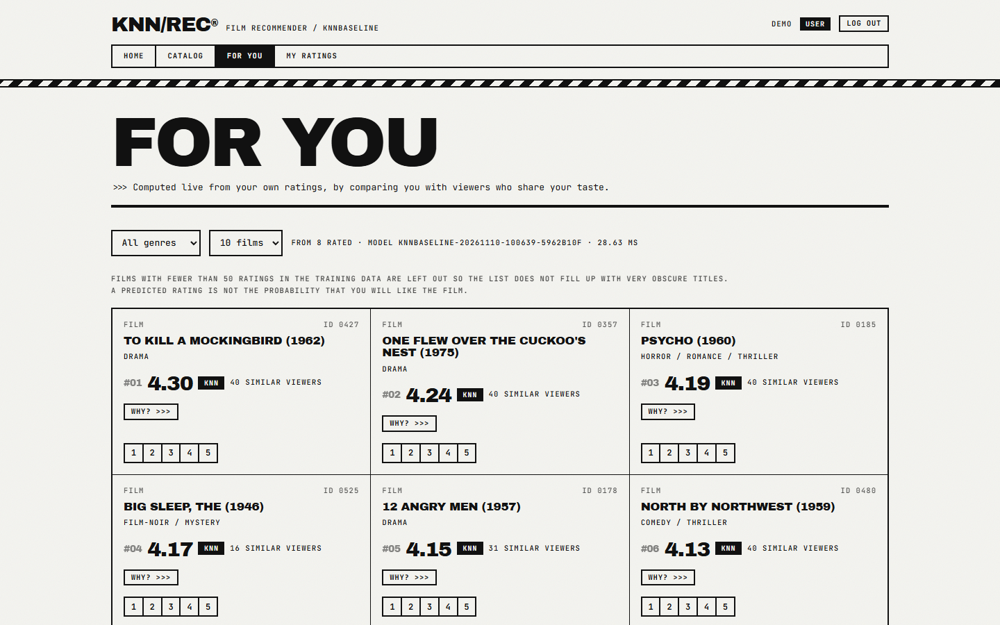

# KNN/REC: hệ thống đề xuất phim cá nhân hóa (KNNBaseline)

[English (đầy đủ)](README.md) · [Kế hoạch dự án](PLAN.md) · [Đặc tả ban đầu](desc.md)

Hệ thống web hoàn chỉnh, từ pipeline dữ liệu đến giao diện trình duyệt, đề xuất phim dựa trên chính các điểm bạn đã chấm. Hệ thống tìm những người xem có gu giống bạn (k-NN theo người dùng), sau khi học xem mỗi người chấm điểm "rộng rãi" đến đâu và mỗi phim được đánh giá tốt đến đâu (**KNNBaseline**: bias học bằng ALS, tương đồng Pearson-baseline, shrinkage). Dữ liệu thật là [MovieLens 100K](https://grouplens.org/datasets/movielens/100k/); đề xuất được tính trực tiếp trong API, không phải kết quả tính sẵn.

Làm cho môn *Hệ thống thông minh* (HK261). Thuật toán được tự cài bằng NumPy, có test tính tay.



> Giao diện web dùng **tiếng Anh** và phong cách Brutalist. Tài liệu này giải thích cách chạy; phần chi tiết (API, cấu hình, sơ đồ) xem [README.md](README.md).

## Ba vai trò

| Vai trò | Chức năng |
|---|---|
| **User** | Đăng ký, chấm điểm 1–5, tìm phim, nhận đề xuất kèm giải thích ("Why?"), sửa/xóa điểm và thấy danh sách đổi ngay. Người mới thấy phim phổ biến (cold start) cho đến khi chấm vài phim. |
| **Admin** | Tổng quan hệ thống (mô hình đang chạy, độ trễ, tỉ lệ fallback), quản lý tài khoản, ẩn phim khỏi mọi đề xuất, xem đề xuất cho hồ sơ MovieLens. |
| **Data scientist** | Báo cáo dữ liệu và split, chạy job huấn luyện, quản lý phiên bản mô hình và kích hoạt (hot-swap, không cần khởi động lại), so sánh 5 mô hình, đường cong tuning, phân tích lỗi. |

Quyền được kiểm tra ở phía server.

## Chạy nhanh

**Yêu cầu:** Python 3.11+, Node 20+, có mạng một lần để tải MovieLens 100K (~5 MB). Đã kiểm chứng trên Windows 11 (Python 3.12, Node 24); lệnh cho macOS/Linux là bản tương đương chuẩn nhưng chưa chạy thử.

```bash
git clone https://github.com/Kryslogem/knn-recommend.git
cd knn-recommend

# 1. Môi trường Python
python -m venv .venv
#   kích hoạt:  PowerShell: .venv\Scripts\Activate.ps1 | Git Bash: source .venv/Scripts/activate | macOS/Linux: source .venv/bin/activate
python -m pip install -r backend/requirements.txt

# 2. Dữ liệu: tải, kiểm tra SHA-256, làm sạch, chia theo người dùng 70/15/15 (seed 42)
python scripts/prepare_data.py

# 3. Huấn luyện bằng cấu hình đã chốt và kích hoạt (~1 phút)
python scripts/train.py --activate

# 4. CSDL + 3 tài khoản mẫu (admin, datasci, demo)
python scripts/seed_db.py

# 5. Backend (terminal 1). Tài liệu API: http://127.0.0.1:8000/docs
python -m uvicorn backend.app.main:app --port 8000

# 6. Frontend (terminal 2). Ứng dụng: http://localhost:5173
cd frontend
npm install
npm run dev
```

Mở <http://localhost:5173>, **đăng ký** để thử luồng người dùng, hoặc đăng nhập bằng tài khoản mẫu. `seed_db.py` tự sinh mật khẩu ngẫu nhiên và ghi vào `.env` (đã bị `.gitignore`, không in ra màn hình): mở `.env` để xem `KNN_SEED_ADMIN_PASSWORD`, `KNN_SEED_DS_PASSWORD`, `KNN_SEED_USER_PASSWORD`.

Trang **Evaluation** của Data scientist cần báo cáo, tạo một lần bằng:

```bash
python scripts/tune.py        # ~7 phút, grid search trên validation
python scripts/evaluate.py    # ~4 phút, 5 mô hình; test chỉ chạy một lần cho mỗi cấu hình
```

## Kết quả đã đo (tập test, cấu hình đã chốt)

| Mô hình | RMSE | NDCG@10 |
|---|---:|---:|
| Phim phổ biến | 1,0342 | 0,0822 |
| Chỉ bias | 0,9423 | 0,0679 |
| KNNBasic | 1,0181 | 0,0738 |
| KNNBaseline không shrinkage | 0,9347 | 0,0572 |
| **KNNBaseline đầy đủ** | **0,9281** | 0,0824 |

KNNBaseline dự đoán điểm tốt nhất và đề xuất đa dạng hơn, nhưng về xếp hạng chỉ **ngang** mô hình phim phổ biến (chênh lệch nằm trong sai số, chưa có khoảng tin cậy). Độ trễ Top-10: p50 50 ms, p95 70 ms (mục tiêu 2 giây).

## Xử lý sự cố nhanh

| Hiện tượng | Cách xử lý |
|---|---|
| `503 model_not_loaded` / trang "For you" trống | Chưa có mô hình kích hoạt: chạy `python scripts/train.py --activate` rồi khởi động lại backend, hoặc kích hoạt ở trang *Model versions*. |
| Trang Evaluation báo "Report not available yet" | Chạy `scripts/tune.py` và `scripts/evaluate.py`. |
| Mỗi request chậm ~2 giây | Dùng `127.0.0.1` thay cho `localhost` (Windows thử IPv6 trước). |
| Quên mật khẩu tài khoản mẫu | Mở `.env`. |
| Muốn làm lại CSDL | `python scripts/seed_db.py --reset` (xóa mọi tài khoản và rating đã tạo trên web). |

## Dữ liệu, giấy phép, giới hạn

Dữ liệu MovieLens 100K **không** được phân phối lại trong repo; script tải trực tiếp từ GroupLens (xem [điều khoản](https://files.grouplens.org/datasets/movielens/ml-100k-README.txt) và trích dẫn Harper & Konstan, 2015). Mã nguồn theo giấy phép MIT ([LICENSE](LICENSE)). Dữ liệu năm 1997–98 nên danh mục cũ; chia ngẫu nhiên đo khả năng khôi phục sở thích bị che chứ không dự báo tương lai; điểm dự đoán không phải xác suất thích.
