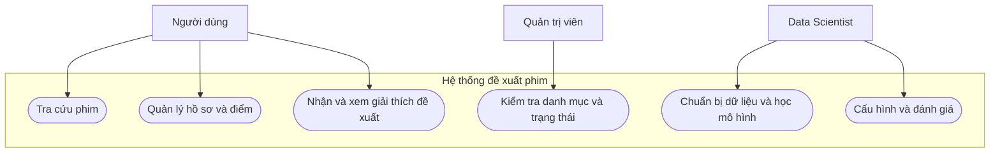
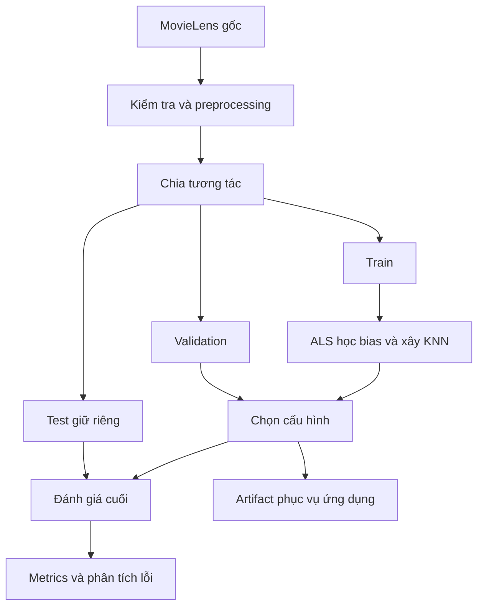
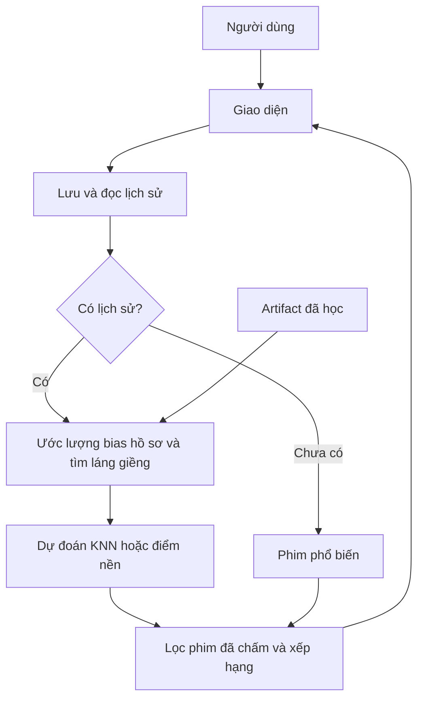

# MÔ TẢ DỰ ÁN: HỆ THỐNG ĐỀ XUẤT PHIM CÁ NHÂN HÓA BẰNG KNNBASELINE

**Môn học:** Hệ thống thông minh (Intelligent Systems)  
**Project title:** Personalized Movie Recommendation with Bias-Learning KNN  
**Thuật toán chính:** User-based KNNBaseline + ALS + Pearson-baseline shrinkage  
**Dataset:** MovieLens 100K  
**Thời gian:** 7–8 tuần  
**Cập nhật:** 19/10/2026  
**Trạng thái:** Đặc tả trước triển khai; chưa có kết quả thực nghiệm.

Tài liệu mô tả hệ thống, các yêu cầu và quy trình ML ở mức đủ để bắt đầu phát triển. Các bước preprocessing và splitting là định hướng cơ bản; cấu hình và kết quả phải được kiểm chứng sau. Xem [README](README.md) để đọc bản tổng quan.

## 1. Project overview — Tổng quan

Người dùng có nhiều lựa chọn phim nhưng danh sách phổ biến chưa phản ánh sở thích riêng. Hệ thống nhận lịch sử chấm điểm, tìm người có cách đánh giá tương đồng và đề xuất phim chưa được người dùng đánh giá.

Phương pháp chính là **KNNBaseline**. Mô hình học xu hướng chấm điểm của từng người và xu hướng điểm của từng phim trước khi tổng hợp ý kiến láng giềng. Vì vậy, hệ thống có cả bước học tham số và bước tìm láng giềng.

Câu hỏi nghiên cứu: việc học bias và giảm ảnh hưởng của độ tương đồng ít bằng chứng có cải thiện chất lượng so với KNNBasic và các mô hình đối chứng không?

## 2. Problem statement — Bài toán

- **Dữ liệu có sẵn:** đánh giá người dùng–phim và thông tin phim.
- **Đầu vào một lượt sử dụng:** hồ sơ và các điểm chấm, bộ lọc tùy chọn.
- **Đầu ra:** tối đa 10 phim chưa đánh giá, được xếp theo điểm dự đoán; có thông tin nguồn và giải thích.
- **Kiểu bài toán:** dự đoán điểm và xếp hạng đề xuất, không phải phân loại thể loại phim.

“Chưa đánh giá” không đồng nghĩa chắc chắn chưa xem. Điểm dự đoán không phải xác suất thích phim.

### Ví dụ cơ bản

| Phim người dùng đã xem | Điểm chấm |
|---|---:|
| Toy Story (1995) | 5 |
| Star Wars (1977) | 5 |
| Fargo (1996) | 2 |

Hệ thống dùng các điểm này làm hồ sơ truy vấn, tìm láng giềng và đề xuất những phim khác. Ví dụ chỉ mô tả đầu vào; tên phim và điểm đầu ra phải được tính từ mô hình thật, không ghi sẵn trong ứng dụng.

## 3. Objectives — Mục tiêu

| Mã | Mục tiêu | Minh chứng hoàn thành |
|---|---|---|
| O1 | Cá nhân hóa đề xuất | Kết quả được tính từ lịch sử của hồ sơ hiện tại |
| O2 | Có bước học tham số | Học và lưu bias người dùng/phim từ train |
| O3 | Kiểm chứng cải tiến | So sánh cùng split, metrics, ứng viên và quy tắc fallback |
| O4 | Xây hệ thống chạy được | Luồng tìm phim → chấm điểm → nhận đề xuất hoạt động |
| O5 | Tái lập thực nghiệm | Có nguồn dữ liệu, seed, cấu hình và artifact |
| O6 | Đáp ứng rubric | Có yêu cầu, use case, thiết kế, đánh giá, kiểm thử và bộ nộp |

Không cam kết trước mô hình nâng cao luôn thắng hoặc đạt một tỷ lệ chính xác cụ thể.

## 4. Stakeholders và actors

| Vai trò | Loại | Nhu cầu hoặc trách nhiệm |
|---|---|---|
| Người dùng xem phim | Actor | Tìm phim, chấm điểm, nhận gợi ý |
| Quản trị viên | Actor | Kiểm tra danh mục và trạng thái hệ thống |
| Data Scientist | Actor | Chuẩn bị dữ liệu, cấu hình, học bias, đánh giá và cập nhật mô hình |
| Nhóm phát triển | Stakeholder | Triển khai, tích hợp, kiểm thử, tài liệu |
| Giảng viên/người đánh giá | Stakeholder | Kiểm chứng phương pháp, kết quả, demo và đóng góp |

Một thành viên có thể kiêm nhiều trách nhiệm, nhưng vai trò Data Scientist cần được thể hiện rõ trong thiết kế.

## 5. Scope — Phạm vi

### Trong phạm vi MVP

- Nhập và kiểm tra MovieLens 100K.
- Tìm kiếm tên phim, lọc thể loại, xem thông tin cơ bản.
- Chọn hồ sơ demo, tạo hồ sơ mới, lưu và sửa điểm 1–5 sao.
- Học bias bằng ALS; tính tương đồng, dự đoán và tạo Top 10.
- Fallback, giải thích đề xuất và lưu phiên bản mô hình.
- Đánh giá offline, kiểm thử tích hợp, báo cáo và demo.

### Ngoài phạm vi

Phát phim, thanh toán, tích hợp tài khoản nền tảng xem phim, hạ tầng quy mô thương mại và deep learning. Hybrid nội dung và thử SGD được xem là mở rộng sau khi MVP hoàn thành.

## 6. Functional requirements — Yêu cầu chức năng

| Mã | Chức năng | Điều kiện nghiệm thu |
|---|---|---|
| FR01 | Tra cứu phim | Tìm theo tên và lọc đúng thể loại |
| FR02 | Quản lý hồ sơ | Tạo/chọn hồ sơ; không trùng ID dữ liệu lịch sử |
| FR03 | Quản lý đánh giá | Lưu/sửa điểm 1–5; một điểm hiện hành cho mỗi cặp người–phim |
| FR04 | Xem lịch sử | Hiển thị đúng các điểm đã lưu của hồ sơ |
| FR05 | Nhận đề xuất | Tính bằng mô hình thật, loại phim đã chấm, trả tối đa N |
| FR06 | Giải thích | Hiển thị nguồn KNN/bias/phổ biến và số láng giềng thực tế |
| FR07 | Xử lý cold start | Hiển thị phim phổ biến, mời chấm điểm để khởi tạo |
| FR08 | Học và cập nhật | Data Scientist chạy pipeline, lưu bias, cấu hình và phiên bản |
| FR09 | Đánh giá | Xuất metrics và bảng đối chiếu mô hình |
| FR10 | Kiểm tra dữ liệu | Từ chối rating/ID sai; báo lỗi file nhập không hợp lệ |

## 7. Non-functional requirements — Yêu cầu phi chức năng

| Mã | Yêu cầu | Cách kiểm chứng |
|---|---|---|
| NFR01 | Hiệu năng | Mục tiêu trả Top 10 trong khoảng 2 giây sau khi nạp artifact trên máy demo; báo cấu hình máy và số đo |
| NFR02 | Tái lập | Cố định dữ liệu, split, seed, thư viện và cấu hình |
| NFR03 | Nhất quán | Điểm đã lưu còn sau khởi động; cập nhật điểm làm mới cache |
| NFR04 | Dễ sử dụng | Luồng đánh giá và nhận gợi ý rõ ràng |
| NFR05 | Phân vai | Chức năng học/cập nhật mô hình chỉ ở chế độ quản trị hoặc lệnh dành riêng |
| NFR06 | Dễ bảo trì | Tách dữ liệu, mô hình, dịch vụ và giao diện |
| NFR07 | Tối thiểu hóa dữ liệu cá nhân | Dùng hồ sơ giả danh, không cần tên thật/thông tin liên hệ |

Bộ chọn hồ sơ là tiện ích demo, không phải xác thực. Nếu triển khai công khai nhiều người dùng, bổ sung xác thực và kiểm tra quyền phía xử lý.

## 8. Use-case diagram

Mermaid dưới đây là sơ đồ chức năng–tác nhân tương đương use case ở mức khái quát, không phải ký pháp UML use case chuẩn. Có thể chuyển thành sơ đồ UML hình ellipse khi hoàn thiện báo cáo.



## 9. Use-case descriptions

### UC01 — Nhận đề xuất phim

| Thuộc tính | Mô tả |
|---|---|
| Actor | Người dùng |
| Tiền điều kiện | Hồ sơ tồn tại; danh mục và mô hình đã nạp |
| Kích hoạt | Chọn “Đề xuất phim” |
| Hậu điều kiện | Nhận danh sách có nguồn rõ ràng, không chứa phim đã chấm |

**Luồng chính:**

1. Đọc lịch sử của hồ sơ và bộ lọc.
2. Ước lượng bias của hồ sơ truy vấn nếu lịch sử mới/thay đổi.
3. Tìm láng giềng hợp lệ và dự đoán các phim ứng viên.
4. Loại phim đã chấm, xếp hạng và chọn Top N.
5. Hiển thị phim, điểm ước lượng, nguồn và mức hỗ trợ.

**Luồng thay thế:** chưa có lịch sử thì dùng phổ biến; thiếu láng giềng thì dùng điểm nền nếu có bias phù hợp. Bộ lọc quá hẹp thì trả ít hơn N và thông báo.

### UC02 — Học và đánh giá mô hình

| Thuộc tính | Mô tả |
|---|---|
| Actor | Data Scientist |
| Tiền điều kiện | Dữ liệu đã kiểm tra; các tập train/validation/test cố định |
| Kích hoạt | Chạy pipeline với cấu hình |
| Hậu điều kiện | Có artifact và kết quả tái lập, test không dùng để chọn tham số |

**Luồng chính:**

1. Đọc train, tính trung bình và học bias bằng ALS.
2. Tính similarity có shrinkage, xây bộ dự đoán KNN.
3. Đánh giá cấu hình trên validation, chốt phương án.
4. Chạy test cho cấu hình cuối; so sánh các mô hình đối chứng.
5. Lưu metrics, seed, phiên bản dữ liệu và cấu hình.

**Luồng thay thế:** dữ liệu sai thì dừng; không đủ cơ sở dự đoán thì ghi fallback/coverage, không âm thầm bỏ mẫu khó.

## 10. Kiến trúc và data flow

### 10.1. Thành phần dự kiến

| Thành phần | Công nghệ/Trách nhiệm |
|---|---|
| Giao diện | Streamlit; tìm phim, chấm điểm, xem đề xuất |
| Dịch vụ | Đọc hồ sơ, gọi mô hình, lọc và giải thích |
| Mô hình | KNNBaseline; ALS học bias, similarity và dự đoán |
| Dữ liệu vận hành | SQLite; danh mục, hồ sơ và đánh giá mới |
| Pipeline offline | Python; preprocessing, splitting, training, evaluation |
| Artifact | Bias, ma trận train, similarity, mapping, cấu hình và metrics |

Surprise có thể làm bản triển khai tham chiếu. Nhóm cần giải thích được phần học và dự đoán; không chỉ gọi thư viện mà không hiểu quy trình.

### 10.2. Luồng dữ liệu offline



Test chỉ được dùng ở bước cuối. Artifact của thí nghiệm này vẫn xây từ train để bảo đảm quy trình nhất quán. Nếu sau đó huấn luyện lại trên dữ liệu rộng hơn cho demo, tạo phiên bản riêng và không gắn metrics test cũ cho mô hình mới.

### 10.3. Luồng dữ liệu online



Đánh giá người dùng mới là dữ liệu vận hành. Không tự trộn chúng vào tập test hoặc cộng đồng tham chiếu nếu chưa chạy cập nhật mô hình có phiên bản.

### 10.4. Lưu trữ tối thiểu

| Dữ liệu | Nội dung |
|---|---|
| `users` | ID hồ sơ, loại hồ sơ, thời điểm tạo |
| `movies` | ID, tên, thể loại, ngày phát hành |
| `ratings` | ID người, ID phim, điểm, thời gian, nguồn; khóa duy nhất theo cặp |
| `model_versions` | Phiên bản, cấu hình, hash dữ liệu, đường dẫn artifact |

## 11. Dataset

MovieLens 100K có 100.000 lượt đánh giá của 943 người trên 1.682 phim, thang điểm 1–5, được thu thập năm 1997–1998.

- Chính thức: <https://grouplens.org/datasets/movielens/100k/>
- ZIP: <https://files.grouplens.org/datasets/movielens/ml-100k.zip>
- README gốc: <https://files.grouplens.org/datasets/movielens/ml-100k-README.txt>
- Hugging Face tham khảo: <https://huggingface.co/datasets/includeno/movielens-100k/tree/main>

| File | Sử dụng |
|---|---|
| `u.data` | Bốn cột phân cách tab: người dùng, phim, rating, timestamp |
| `u.item` | Thông tin phim phân cách `|`, gồm tên và cờ thể loại |
| `u.genre`, `u.info` | Diễn giải thể loại và đối chiếu số lượng |

Không cần dùng `u.user` cho MVP. Dataset đủ về cấu trúc cho hệ đề xuất; chưa có kiểm chứng chất lượng mô hình. Đọc điều kiện gốc trước khi dùng; repo nên hướng dẫn tải thay vì phân phối lại dữ liệu.

## 12. Data preprocessing — Mức cơ bản

1. Đọc file bằng đúng dấu phân cách và kiểm tra encoding.
2. Chuẩn hóa tên cột và kiểu dữ liệu; kiểm tra rating trong 1–5.
3. Kiểm tra thiếu, trùng cặp người–phim và mã phim không có trong danh mục; ghi quy tắc xử lý.
4. Khám phá số lượt đánh giá mỗi người/phim, phân bố điểm và độ thưa.
5. Chia dữ liệu, sau đó tạo mapping, ma trận và thống kê phục vụ mô hình.

Các ô chưa đánh giá vẫn là thiếu; không diễn giải thành 0 sao. User ID và movie ID chỉ là định danh, không đo khoảng cách trên giá trị mã. Không bắt buộc Min-Max scaling toàn bộ rating vì thuật toán đã điều chỉnh bằng điểm nền.

## 13. Data splitting và chống leakage — Mức cơ bản

- Chia tương tác ngẫu nhiên theo từng người: khoảng 70% train, 15% validation, 15% test; cố định seed và quy tắc làm tròn.
- Giữ đủ lịch sử train cho mỗi người được đánh giá theo kịch bản warm start; công bố tiêu chí đủ lịch sử.
- Train dùng học bias và similarity; validation dùng chọn cấu hình; test dùng đánh giá cuối.
- Mọi thống kê điểm, độ phổ biến, lọc theo tần suất và similarity chỉ lấy từ train.
- Hồ sơ truy vấn trong đánh giá không được chứa điểm validation/test.
- Phim/người không có hỗ trợ phải được ghi nhận và xử lý fallback.

Cách chia này đo khả năng khôi phục sở thích bị giữ lại, không chứng minh dự báo tương lai. Nếu thử chia theo thời gian, trình bày thành thí nghiệm riêng. Không trộn các file chia sẵn của MovieLens với cách chia chính mà không mô tả lại.

## 14. Thuật toán sử dụng — Mô tả đơn giản

### 14.1. Bước học tham số

Điểm nền:

$$b_{ui}=\mu+b_u+b_i.$$

Trong đó `mu` là trung bình train; `b_u` là độ lệch người dùng và `b_i` là độ lệch phim. Mục tiêu thiết kế là giảm sai số bình phương có regularization:

$$\sum_{(u,i)\in Train}(r_{ui}-\mu-b_u-b_i)^2
+\lambda_u\sum_u b_u^2+\lambda_i\sum_i b_i^2.$$

Chọn **ALS** làm phương pháp chính: luân phiên cố định bias phim để cập nhật bias người dùng, rồi cố định bias người dùng để cập nhật bias phim. Lặp một số vòng. SGD là phương án thay thế; không bắt buộc triển khai cả hai trong MVP.

### 14.2. Bước láng giềng

Từ phần điểm còn lại sau khi trừ điểm nền, tính Pearson-baseline và giảm độ tương đồng thiếu bằng chứng bằng shrinkage. Chỉ giữ cặp có đủ phim chung và tương đồng dương.

Với phim i, chọn tối đa K người tương đồng đã chấm phim đó. Điểm dự đoán là:

```text
Điểm nền của người dùng và phim
+ trung bình có trọng số của phần dư đánh giá từ các láng giềng
```

Chặn kết quả về 1–5. Số láng giềng thực tế có thể nhỏ hơn K; nếu không đạt ngưỡng tối thiểu, dùng điểm nền và gắn nhãn nguồn.

### 14.3. Tham số học và siêu tham số

| Loại | Ví dụ | Cách xác định |
|---|---|---|
| Tham số mô hình | Bias người dùng/phim | Học từ train bằng ALS |
| Thống kê | Trung bình toàn train | Tính trực tiếp từ train |
| Siêu tham số | K, regularization, số vòng, shrinkage, số phim chung tối thiểu | Chọn trên validation |
| Cấu hình sản phẩm | N = 10 phim | Quyết định phạm vi ứng dụng |

Không khẳng định mô hình học embedding hoặc tự học metric. Phần học trong thiết kế này là bias; cấu trúc láng giềng được xây từ dữ liệu.

### 14.4. Người dùng mới và cập nhật điểm

Bias/similarity có sẵn của một mô hình đã fit không tự cập nhật khi SQLite có điểm mới. Ứng dụng phải có bước suy luận hồ sơ:

- Chưa có điểm: hiển thị phim phổ biến.
- Có điểm cho các phim đã biết: giữ bias phim đã học, ước lượng bias riêng của hồ sơ truy vấn bằng trung bình phần dư có regularization; tính lại similarity giữa hồ sơ đó với cộng đồng train.
- Với hồ sơ đã sửa điểm: dùng toàn bộ lịch sử hiện hành được phép sử dụng và làm mới cache.
- Chỉ đưa hồ sơ mới vào cộng đồng tham chiếu qua lần cập nhật mô hình có phiên bản.

Đây là phần mở rộng suy luận cần viết riêng nếu dùng Surprise. Chỉ gọi `predict` với một ID chưa có trong train sẽ không tự tạo cá nhân hóa từ các điểm vừa lưu.

### 14.5. Top N và fallback

Loại các phim đã chấm, áp dụng bộ lọc, xếp hạng theo điểm. Điểm có thể từ KNN hoặc bias-only khi thiếu láng giềng; ghi nguồn từng mục. Người không có hồ sơ dùng danh sách phổ biến tính từ train. “Baseline” trong KNNBaseline là điểm nền, khác mô hình đối chứng phim phổ biến.

## 15. Evaluation — Đánh giá dự kiến

### Các mô hình cần so sánh

| Mô hình | Mục đích |
|---|---|
| Phim phổ biến | Đối chứng xếp hạng không cá nhân hóa |
| Bias-only | Kiểm tra phần học bias khi không có láng giềng |
| KNNBasic với Pearson thường | Mốc láng giềng không học bias |
| KNNBaseline không shrinkage | Tách tác động của học bias và similarity tương ứng |
| KNNBaseline có shrinkage | Phương án đầy đủ |

Giữ các yếu tố chung ổn định khi so sánh. Nếu đổi đồng thời nhiều thành phần, không quy toàn bộ cải thiện cho riêng một thành phần. Thử item-based hoặc SGD chỉ sau khi hoàn thành bộ chính.

### Chỉ số và quy tắc cơ bản

- **MAE/RMSE:** sai số điểm dự đoán; dùng bias-only làm đối chứng và ghi rõ fallback.
- **Precision@10, Recall@10, NDCG@10:** chất lượng xếp hạng; phim liên quan là phim giữ lại có điểm từ 4 sao.
- **Coverage, tỷ lệ fallback, độ trễ:** mức hỗ trợ và tính thực dụng.
- Tập ứng viên là danh mục chưa chấm trong train, không chỉ các phim được chọn thuận lợi.
- Recall/NDCG tính trên nhóm có phim liên quan; báo số người đủ điều kiện và quy tắc loại.
- Nếu trả ít hơn 10 phim, vẫn dùng mẫu số 10 cho Precision@10.
- Dữ liệu không quan sát không đồng nghĩa người dùng không thích; ghi giới hạn của đánh giá offline.

Báo cáo toàn hệ thống có fallback, kèm tỷ lệ dự đoán có hỗ trợ KNN. Chưa có kết quả đo; không điền số liệu giả. Phân tích cả trường hợp cải tiến không hiệu quả.

## 16. Kiểm thử và rủi ro

| Kiểm thử/Rủi ro | Kết quả hoặc hướng xử lý |
|---|---|
| Rating ngoài miền, ID sai | Từ chối và báo lỗi |
| Điểm trùng, sửa điểm, khởi động lại | Cập nhật đúng và lưu bền |
| Người mới, ít phim chung | Fallback đúng nguồn |
| Phim đã đánh giá | Không xuất hiện trong đề xuất |
| Cập nhật điểm | Bias hồ sơ, similarity và cache phản ánh lịch sử mới |
| Leakage | Artifact chỉ dựa trên train, split và phiên bản rõ ràng |
| KNN không thắng baseline | Phân tích độ thưa, support và metric; không thay quy trình để làm đẹp kết quả |
| Tốc độ hoặc UI quá phức tạp | Giữ dataset 100K và ưu tiên luồng chính |

Đối chiếu bias/láng giềng trên ví dụ tính tay nhỏ; những dữ liệu kiểm thử này không thay dataset thật trong đánh giá ML.

## 17. Kế hoạch 8 tuần

| Tuần | Công việc chính | Kết quả |
|---|---|---|
| 1 | Chốt đề tài, scope, stakeholder, dataset | Đề cương và kiểm tra dữ liệu |
| 2 | Yêu cầu, use case, kiến trúc và data flow | Bộ thiết kế |
| 3 | Preprocessing, splitting, đối chứng | Pipeline và baseline |
| 4 | Học bias, KNNBaseline, tuning validation | Mô hình và cấu hình được chọn |
| 5 | Giao diện, SQLite, suy luận hồ sơ mới | MVP tích hợp |
| 6 | Test cuối, coverage, lỗi và tốc độ | Kết quả thực nghiệm và kiểm thử |
| 7 | Hoàn thiện và viết báo cáo/README | Tài liệu gần hoàn chỉnh |
| 8 | Slide, demo, Q&A, đóng gói | Bộ nộp hoàn chỉnh |

Nếu có 7 tuần, gộp hai tuần cuối và viết báo cáo từ tuần 2.

## 18. Đối chiếu rubric và bàn giao

| Nhóm tiêu chí | Điểm | Bằng chứng |
|---|---:|---|
| Problem & requirements | 10 | Mục tiêu, scope, stakeholder có Data Scientist và yêu cầu |
| Analysis & design | 15 | Use case, mô tả, kiến trúc, UI/data flow |
| Data & ML workflow | 15 | Nguồn dữ liệu thực, preprocessing, split, chống leakage |
| Algorithm & evaluation | 25 | Học bias, KNN, cài đặt, metrics, baseline, phân tích lỗi |
| System & integration | 25 | MVP, tích hợp thật, kiểm thử và xử lý đầu vào |
| Demo & report | 10 | Demo/Q&A, PDF, đóng góp và khai báo AI |

Bộ bàn giao: source code; README với lệnh chạy đã kiểm chứng và hướng dẫn dữ liệu; báo cáo PDF; slide và live demo; bảng đóng góp; khai báo sử dụng Generative AI. Hai tài liệu Markdown hiện tại là nền thiết kế, chưa thay thế các sản phẩm triển khai.

## 19. Nguồn tham khảo

1. Rubric được cung cấp: `HK261_IS_Assignment_Rubric.pdf`.
2. [GroupLens MovieLens 100K](https://grouplens.org/datasets/movielens/100k/) và [README gốc](https://files.grouplens.org/datasets/movielens/ml-100k-README.txt).
3. [Surprise: cấu hình học baseline bằng ALS/SGD](https://surprise.readthedocs.io/en/stable/prediction_algorithms.html).
4. [Surprise: KNNBaseline và các biến thể](https://surprise.readthedocs.io/en/stable/knn_inspired.html).
5. [Surprise: similarity và shrinkage](https://surprise.readthedocs.io/en/stable/similarities.html).

Các lựa chọn kiến trúc, xử lý hồ sơ mới và quy trình thực nghiệm là thiết kế dự kiến của nhóm; cần được triển khai và kiểm chứng. Dữ liệu nguồn và thuật toán tham chiếu không bảo đảm trước chất lượng của hệ thống.

**Khai báo AI:** tài liệu được soạn với sự hỗ trợ của ChatGPT. Nhóm cần cập nhật đóng góp và phạm vi hỗ trợ AI thực tế khi nộp, đồng thời tự kiểm tra tính đúng của mã nguồn, kết quả và giải thích.
